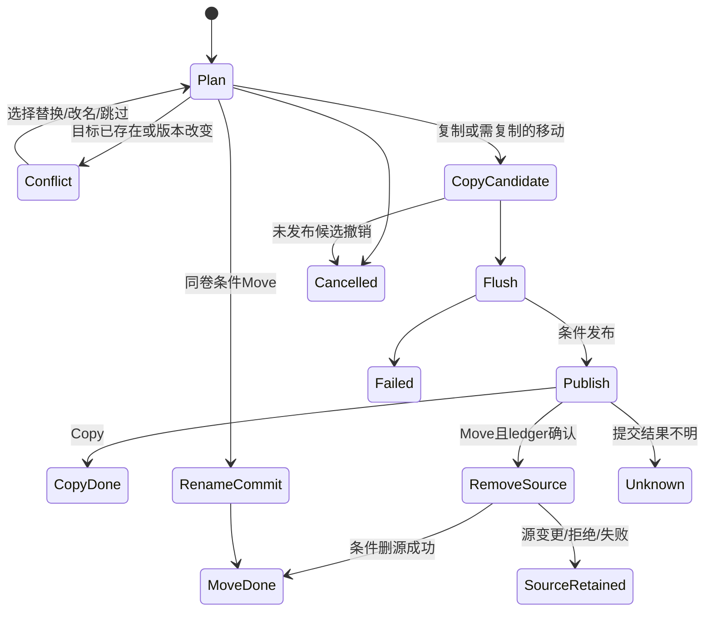

# Files 2：目录、选择与文件作业设计

所属版本：**SandCore M10a2 — The Application Platform Era**。2026-10-15，Phase 6 的源码审计与设计，状态为 **DESIGN_ONLY**。本次仅新增本文件；Files2 应用、清单、资源与接线尚未实现，没有构建或运行。当前平台的构建、GCC/原生来源及失败沿革由主代理分别记录，不能用本设计或旧 Files 证据宣布 Files2 已完成。

范围完整保留根 `M10a2RULE.MD` §7.1：目录树、详细表格、表头排序与列宽、多选、复制/剪切/粘贴、文件和目录拖放、改名/创建/删除、属性、类型关联与图标、搜索/过滤、右键菜单、复制/移动进度、地址/工具/状态栏以及错误恢复。系统依赖采用 [SCSHELL-DESIGN.md](SCSHELL-DESIGN.md) 已确定的 caller-owned worker、lease、逐项 ledger 与持久 ACK；不另造文件搬运或桌面服务协议。

## 1. 审计基线与保真清单

已完整阅读根 M10a2RULE、[组件审计](M10A2-COMPONENT-AUDIT.md)、`user/files.c`、[旧 Files 合同](FILES.md)，以及当前 SCUI/SCLIB/SC32/Broker/Drop 公共头、File/Broker/Drop/FS/Auth 规范和 SCSHELL 两份设计/状态文档。必要的源码核对包括 SC32 的 path/process 桥、SCUI Table/View 输入与 Drop 完成路径。

旧源实际只有261行，直接包含 SCAPI.H 与 NUI.inc；使用 `names[512][64]`、`kinds[512]`、`sizes[512][12]` 和单个 selection。它不是现成的目录树、共享多选或文件事务实现。当前 typed Directory 采用动态对象与64行页预算，没有这份512行 UI 截断；卷自身的 v5 目录容量仍是实际磁盘约束，不能说文件系统无限容量。

| 旧源入口/行为 | Files2 必须保留的结果 | 新接线 |
|---|---|---|
| main/refresh：初始目录、直接子项、空目录 | 有效初始目录可打开，坏参数给原因并保留可用窗口；孙目录不混入直属列表 | 参数完整读取与规范化，ScDirectoryOpen/Next；真正 EOF 才显示空目录 |
| parent/change_path、五处位置 | 上级、完整路径输入、ROOT/HOME/SYS/APPS/BIN 均可达 | 地址栏、树、菜单和原位置命令；窗口目录不依赖全进程 CWD 改写 |
| 单选、双击、j/k/方向键、Prev/Next | 选择/打开、首尾与分页仍可达 | 标准 Selection/View，PageUp/PageDown/滚动取代显式分页；可保旧页命令别名 |
| open_selected：SCX运行或Debug | 原 SCX 与动态 SCX 均能启动，Debug 仍送真实调试入口 | SCSHELL 的 Execute/Debug verb 与正式 launch profile |
| 源码/文本送 IDE | C/H/INC/ASM/TXT/CFG/LOG 的已有编辑入口保留 | 关联种子指向现有 Studio；Studio2 接管前不删除旧入口 |
| 图片送 Lens | 源中已登记 SCB/BMP/PNG/JPG/JPEG/WebP 分派不得遗漏 | 导入关联；解码支持以 Lens 的实际能力/原证据为准，此处只确认分派源码 |
| 未知二进制拒绝 | 不当文本打开后误保存损坏 | Open With 或明确“不支持的类型”，不靠扩展名承诺正文有效 |
| mutation：mkdir、rename/move path、remove | 完整目标确认、创建空目录、改名/路径移动、删除和取消均保留 | SCSHELL 条件作业；Cancel 不刷新/重排旧选择，不把弹窗关闭当提交 |
| path_join、128B输入候选/63B真实身份 | 超长整条拒绝，UTF8显示省略不改变实际路径 | ScString 保存完整候选，ScPathResolve 最终核真 FS 限制，不截断成另一名字 |
| 私有七项右键、紧凑布局 | 外点只关闭菜单，不穿透执行背景删除；极小窗口仍可恢复 | 公共 Menu/Command、实际 hit/clip、响应布局，不复制旧菜单几何 |
| result 与核心保护提示 | 保留真负错误、权限/保护原因和原作品 | 分层 error/cause/raw；内核最终判断，UI不成为唯一权限检查 |
| 隐藏/恢复、Classic/Aurora/VGA | 隐藏不生成客户帧，恢复重画，旧设备/旧应用保留 | SCUI 真实消息/损伤与凤凰字体；不以迁移重启 M8 游戏或旧显示矩阵 |

旧 d/Debug 命令对 SCX 使用 Debugger，其它已支持类型落原默认打开路径；迁移应明确 verb 状态和这一旧快捷行为，不把“Debug”标成所有格式均可调试。旧 Esc 优先关菜单再退出，Enter 打开、Backspace 上级、Ctrl+E 刷新、N 新目录、F2 改名、X 删除与1..5位置仍有可达命令；文本输入焦点时不抢这些普通字符。另加入标准 F5、Delete、Ctrl+C/X/V/A、Ctrl+L 与 Alt+Enter，不改冻结的旧调用。

Files2 初期使用独立 `FILES2.SCX` 与新应用 ID；默认关联/快捷方式切换只在实际验收后由发行接线完成。`user/files.c`、原 FILES.SCX、历史证据和用户目录保留，不整树/整盘复制归档，不用 NUI 静态复制支撑新应用。

### 当前公共头的边界

| 能力 | 已有真实公开接口 | 不能外推的能力 |
|---|---|---|
| 目录/元数据 | ScDirectoryOpen/Next/Close、ScPathStat/Metadata | 行 generation 为可变版本；没有公开持久 birth ID、修改时间或完整 FS watch |
| 文件对象 | ScFileOpen/Read/Write/Flush/Query/Close、object_id/revision、真实 IO prefix | 普通 open-pin 不阻止另一 modern writer；Flush 不是多文件原子提交 |
| 路径修改 | ScPathCreate 真实 CREATEEX、ScPathRename/Remove/Permissions | 无持 pin 条件覆盖/删除 API；close→rename/remove 有身份空窗，不能冒充 lease |
| GUI 数据与菜单 | SCUI 158入口、provider/selection、Tree/Table、Menu/Command、Dialog | Table 已有表头排序与拖列宽；当前没有公开列宽读取/变更记录，不能猜私有 UiView |
| 剪贴板 | FILES16B头/20B记录、immutable snapshot、CAS、大 Offer/分段 Read | FILES/CUT 只是意图，不授予文件读取、覆盖或删源权 |
| 拖放 | 真实144B DropInfo、票据/peer、SCUI Drag/Drop | 通用 COMPLETE 不证明磁盘提交；DROP callback 目前没有公开延迟 ACK 对象 |
| 启动/作业 | ScProcessSpawn、ScJob*、真 PID/gen 与端点 | 现 Spawn 是 managed job；独立 GUI session-lifetime launch 仍待 SCSHELL/SC32 新合同 |

截至本次审阅，SCSHELL-DESIGN/IMPLEMENTATION 已落盘，`user/SCSHELL.H` 和正式 worker/lease 接口尚未出现。以下引用其中拟议函数族时均为待冻结的消费合同，不是已存在的声明或 exports。

## 2. 产品排版与窗口结构

默认请求约900×560物理客户像素，具体尺寸由实际 WindowQuery/SCUI layout决定。内容采用96基准逻辑布局与真实 Metrics：菜单、工具、地址/过滤、目录/表格工作区、状态/作业五层。标题显示当前真实位置；目录根显示卷实际格式，不能继承旧固定“SandFS v4”文案。

| 区域 | 设计起点 | 控件与用途 |
|---|---|---|
| 菜单 | 实际 menu_height | 文件/编辑/查看/工具/帮助，统一命令、快捷键和状态 |
| 工具 | 实际 toolbar_height | 后退/前进/上级、打开、新目录、Copy/Paste、属性；窄窗隐藏次要组到菜单，主操作仍可达 |
| 地址/过滤 | 字高加框/padding，标签短而清楚 | 独立 TextBox 保存输入草稿，Enter 确认；过滤框与清除、递归搜索入口分开 |
| 目录树 | 初始约192逻辑宽，Splitter约4 | 懒展开的 ROOT/位置树；当前目录标记和键盘焦点分开 |
| 文件区 | 弹性填充 | Table 默认详细视图，Name/Type/Size/Owner/Group/Permissions；列表/图标视图用同一数据/选择，图标网格只复用正式公共视图能力或后续共享实现 |
| 状态与作业 | 实际 status_height；有作业才展开进度面板 | 当前目录/显示数量/选择数量/真实错误摘要；作业的完整目标、阶段、bytes/items、Cancel |

不预设用户看不到的时间字段：当前元数据没有 mtime/ctime，“修改时间”列只有未来正式接口真实提供后才加入。Size 是文件真实 u32长度，目录显示“文件夹”或尚未计算，不能填伪零总量。聚合/作业总量用 ScWideCounter，未完成扫描显示不定量进度与已知值。

Classic 使用共同矩形凸凹、焦点/选中/禁用规则；Aurora 使用相同控件、命令和布局。颜色取已登记24个 Theme 角色，字体与省略来自真实凤凰测量，不在应用画固定8px字格、私有按钮或右键浮层。资源图标由 SCSHELL/资源服务提供；ScUiIconLoad 的 SCF/SCB 能力不冒充 SCX 嵌入图标或压缩图片解码。

窄窗可收起树并保留位置菜单，工具组按实际尺寸选择可见项；地址栏、菜单、状态独占空间。表格可为零个可见行并显示放大提示，不能盖住操作栏。100/150/200%读取真实 Metrics 后重排，不缩放整张客户截图。列宽与 splitter 调整使用公共控件；没有公开 getter 时，配置只保存应用明确设置/可查询的值，不把拖动后的私有宽度伪保存。

## 3. 拥有模型与身份

下面都是应用私有业务模型，不是新的内核或 SCUI 结构。实现时先冻结 `FILES2PRIVATE.H`；应用不包含 SCUIPRIVATE.H。

| 对象 | 必须拥有的内容 | 失效与引用 |
|---|---|---|
| FilesApplication/Window | ScUiContext、root/tree/table/address/status、导航历史、命令/菜单、Shell连接 | 每窗独立目录/选区；共享库实例/关联快照有明确retain/release |
| DirectoryCatalog | 规范绝对目录、导航token、目录视图epoch、完整 Entry、排序/过滤候选 | 切目录/取消/STALE撤候选；发布完整新catalog后再释放旧对象 |
| Entry | 单调本地 item ID、拥有 leaf/path、kind/bytes/UID/GID/rw/flags/generation、缓存键 | ID只标本catalog的UI对象，不是filesystem birth ID；执行再核真实文件 |
| DirectoryTree | 节点path、parent ID、子目录载入状态/cursor/revision、错误 | 只为已展开/导航所需分支枚举，不创建全卷控件；收起可回收冷数据 |
| DisplayOrder | order IDs、id→rank索引、sort/filter描述、候选revision | SORT/过滤原子换候选；OOM保原顺序；INDEX_OF不得每次线扫全部行 |
| Selection | 公共 ScUiSelection、当前/anchor、明确选中stable IDs | Ctrl/Shift/全选由库；排序保ID，删除/重建不把旧ID授权到新文件 |
| SearchSession | 独立token、范围/条件、动态目录工作链、真实命中Entry、状态 | Cancel关闭所有游标；旧token结果不进入当前列表；部分结果明确标记 |
| OperationView | owner作业句柄、request双字序号、真实worker PID/gen、逐项ledger/错误、冲突候选 | UI关闭不把业务完成；取消/EOF/未知结果分别记录并交Shell对账 |
| Preferences/Resources | 自有 Config候选、布局设置、关联/图标cache leases | 以配置/资源revision、theme/font/display、SID/权限失效；退出释放全部lease |

路径先用 ScString保存整条候选，再 ScPathNormalize/Join 辅助词法处理，最终 ScPathResolve按真实 CWD/FS规则一次取得绝对值。后续作业只传绝对路径，不由 worker 再叠其 CWD。当前 rootless路径限63B，公共绝对缓冲65B；FS按ASCII不区分大小写、显示保拼写，拒绝空格/冒号等规则仍由实际解析器核验。视觉label、搜索高亮或省略文本不得成为执行身份。

同一catalog内过滤/排序共享 Entry ID。Refresh以规范路径、kind、观察generation匹配可确认项；外部修改造成版本变化或同名重建时，旧动作stamp失效。可以按路径恢复浏览光标，但必须重新确认动作，不宣称它仍是旧对象。由本作业确认的rename结果可明确更新旧item的path/revision；未知外部rename不猜对应关系。

动作创建时 `ScUiSelectionCopy` 固定 IDs，解析为拥有的path/kind/观察版本快照，校验catalog revision仍一致；操作启动后不再从当前高亮行或排序index取目标。包含目录与其后代的重复选择由Shell计划去重，不能重复删除或复制。

## 4. 目录树、表格与搜索 provider

目录枚举每次最多64行，复制 `ScDirectoryEntry.name` 的直属leaf及全部元数据；检查完整UTF8/终止字节、join溢出、page flags/epoch。只有 FINISHED 标志/cursor结束才判EOF，count0不单独代表空目录。64是批次预算；扫描到本页结果可能经过更多磁盘记录，实际成本以后测量，不据行数宣称延迟固定。

导航状态为 `IDLE→LOADING→READY`，或 `ERROR/CANCELLED`。新路径、数据和历史记录先准备候选；全部枚举/排序索引成功后在一个batch内发布地址、tree当前项、table provider、选择与状态。读取拒绝/OOM/STALE保旧目录与输入草稿，不把失败画为空目录。STALE关闭旧cursor，有限退避后按同nav token重开；连续变化允许用户刷新/取消，不无限spin。

Tree provider支持 COUNT/CHILD_COUNT/CHILD_AT/ITEM/CELL/INDEX_OF。未知子分支返回明确 PENDING 后登记一次后台载入；完成发 INSERT/RESET 通知，失败给节点错误与Retry。常用位置仍包含旧五处，再由Shell提供真实用户/会话位置，环境中一个字符串不作为身份授权。父节点与真实path关联，点击导航完成后才改变当前目录标记。

Table provider的 field0为显示名，其它field固定映射kind/type、bytes、UID、GID、rw等已存在字段；所有返回值为拥有缓存借用或规范 ScValue，不能以u32当字符串地址。CELL按可见item/field/revision缓存，展开菜单/hover不逐行重新format/alloc。INDEX_OF返回该parent显示rank，ITEM返回stable ID；当前行不是row index。

表头 SORT 接收真实column field与 `descending | (sort_kind<<8)`。稳定merge-sort按typed值比较，目录优先策略有显式选项，平局按规范名/ID确定；sort过程中保持旧order，候选order与rank都完成后一次发布 SORTED。每步有比较预算，活sort才登记后台工作，鼠标移动不启动全表排序。列宽由 ScUiTableSetColumnWidth 与库实际header capture调整，应用不复制拖线/hit几何。

多选使用库的 Ctrl切换、Shift显示范围、Ctrl+A与stable IDs；ScUiSelection的全选快照/例外成本计入应用，不建每行控件。被过滤但仍选中项的语义显示为“选中N项，其中M项当前可见”，动作确认列出真实全部目标；换目录明确清旧选区，取消导航保旧选区。

快速过滤先支持UTF8 literal/prefix、kind/type与数值范围；ASCII大小写匹配与FS规则一致，不声称完整Unicode casefold。高级文件名 glob与Shell共享正式matcher合同，不能复制 ui_dialog 的私有glob作为第二套SDK。当前目录过滤只重建order/rank，不重复读盘。递归搜索采用动态迭代目录工作链、各目录真实权限和分页；结果记录完整来源path，始终可取消，未知总量不假定100%。拒绝的目录单列错误/跳过数量，不能说搜索完整。

搜索进行中只分批发布已匹配的真实项；取消后保留时标“部分结果/已取消”。根范围、条件或导航token变动撤旧工作和结果引用。结果排序使用同一provider，选择与动作必须再次核当前文件，不因搜索命中授予读取或修改权。

## 5. 事件与共享命令接线

| 真实事件/入口 | 业务处理 | 提交/取消边界 |
|---|---|---|
| Tree/Table SELECTION_CHANGED | Query Selection/current，更新状态与命令资格 | 不在PAINT里执行用户query或文件IO |
| Table左DOWN/UP、Enter | ScUiViewHitTest/当前stable ID，生成 Open命令；双击记录真tick/item/root/input epoch | 按一次真实边沿执行；失焦/失捕获/INPUT_SYNC撤点击候选，不合成UP |
| 右DOWN、菜单键 | 在实际目标处取selection快照，ScUiMenuOpen共享菜单 | 右键命中已选项保多选；未选项先确认选择；空白菜单使用目录本身 |
| COMMAND_QUERY | 按selection/catalog/job/clipboard/Shell事实更新flags与原因 | 禁用只是UI提示；执行仍重新核版本和内核权限 |
| COMMAND | 同一控制器处理菜单、工具、快捷键、属性和批量动作 | 先完整候选后Begin；回调重入销窗后不再用旧node/model |
| address TEXT/Enter | 使用公开TextBox/Document，规范化整条输入并启动navigation | 编辑未确认不切目录；失败保草稿/旧目录，Esc撤草稿 |
| Header SORT/列宽、Splitter、LAYOUT | 公共Table/布局API与provider通知；尺寸/主题改变使布局cache失效 | 不用snapshot猜列宽事件，按公共可观察范围保存 |
| DIALOG_COMPLETE/VALIDATE/APPLY | 取规范Dialog结果/Config候选，创建真实业务请求 | 未知全局COMMAND不关闭Dialog；Cancel/验证失败保旧状态 |
| TIMER/IPC readiness | 推进活目录/search/sort候选、消费Shell真实progress/result/conflict | 完全idle无限等待；只活业务有有限期限，不周期100Hz扫盘/扫PID |
| VISIBILITY37、关闭/退出 | 停止绘画工作，业务IO继续；关闭时处理正在进行的owned作业 | 不借隐藏暂停整个会话；不可把窗口销毁当worker已完成 |
| DRAG_ENTER/OVER/LEAVE/DROP | Query实际可接收目录，交Shell小FILES意图与真sender | 私有payload/schema完整核验；以job ledger而非通用Complete决定文件成功 |

Table当前没有文件激活/双击的独立公共通知；Files2可通过上述应用事件与hit API组成业务命令，而不是复制Table控件。Name列的F2改名优先使用共用TextBox/确认对话框和Shell异步结果；若接COMMIT_EDIT，必须持有UTF8候选并按已冻结的异步业务合同去重，不能把排入job当文件已改名或关闭失败editor。

顶层菜单、右键和工具使用同一 ScUiCommandDesc/ScUiMenuItem，包含Open/Open With/Edit/Debug、New、Copy/Cut/Paste、Rename/Delete、Properties、Refresh、View/Sort/Filter/Search。Shell扩展菜单保持选择快照和provider ID/gen；跨进程只给typed descriptor，不取foreign函数/上下文指针。菜单外点、modal与capture全部走SCUI现合同。

## 6. 属性、关联与文件作业

属性显示真实path、kind、file bytes、UID/GID、六位rw、flags/generation；多选相同字段可显示值，不同字段标“多值”。目录递归总量是可取消的扫描结果，计算前标“未计算”。权限页使用 PropertySheet/Config候选；提交失败保字段草稿和原选择，逐项成功/失败分别展示。资格来自Shell/当前真实identity与规则，最终仍由内核复验，不按名字或UID=-1认SYSTEM。

Open/Open With/Edit/Debug由已冻结的 `ScShellOpen/Launch` 等正式族承担。关联种子保原可执行路径/格式；未知类型选择程序，未知二进制不得自动送文本编辑器。系统默认、用户默认与明确Open With按Shell合同优先；注册不授读文件或执行权。参数按旧/动态SCX实际profile完整编码，拒绝过长，不拼到Shell eval语句。正常GUI使用待新增session-lifetime launch；worker用真实managed job，不能混称现Spawn已detached。

Files2不在COMMAND callback内复制整文件。`ScShellFileOperationBegin/Step/Query/ResolveConflict/Cancel/Close` 由SCSHELL提供；caller-owned SCFILEWORK继承真实主体/SID，64KiB buffer、动态工作树、lease与ledger归worker。GUI只消费真实progress/冲突/结果，用公开ContextStep与Shell Step共同消息泵；纯UI idle不轮询，worker EOF/背压/退出有真事件与明确状态。

操作流程采用Shell已定状态：

总量未知先显示扫描阶段和真实items/bytes；已知总量后用实际确定前缀更新，不以发送、进度100%或弹窗消失判commit。进度为规划、复制、提交、删源和完成的独立阶段；低成本合并重复progress，但不丢失冲突/错误/最终逐项结果。

普通Copy须 READ_STABLE lease、exclusive-create-and-pin候选、写完/Flush后带预期目标条件publish；覆盖不先删目标。新候选mode3、最终权限与发布一同提交，不继承源SYSTEM归属或偷偷公开半成品。目录merge按项，失败不宣称整个树回滚。

同卷Move优先持lease条件rename，成功后不得再remove旧路径。需要copy的Move必须真实目标publish及worker ledger确认，再用exact source lease/path/object/revision条件remove；保持目标保护至删源阶段结束。源变化、权限撤回或目标结果不明时保源；“已复制，源未删除”是独立可恢复结果，不报Move成功。

Delete支持文件/空目录与明确recursive目录计划，迭代postorder、确认去重清单；后台加入的新子项/变化使条件失配，不扩大删除范围。Cancel只撤未发布候选，在有界安全点停止；已提交项留真实结果。EIO/UNCERTAIN沿卷故障规则，不把内存旧目录或恢复记录当掉电回滚保证。

错误记录同时保用户操作、完整source/destination、worker PID/gen、request/序号、commit阶段与Shell/SC32/UTIL cause/domain/raw。Retry前重核，不自动重放超时的Launch/Move/Delete。目录刷新只在确定结果后按受影响parent更新；取消不触旧选择/历史。保留结果详情和真实磁盘差异，短状态栏只显示摘要。

## 7. 文件剪贴板与真正跨窗口拖放

Copy/Cut把selection快照交SCSHELL生成现有FILES格式：16B头、20B row、唯一末NUL的绝对path、精确4B补零，COPY/CUT显式。每项记录真实revision；object_id仅PIN_OBSERVATION时是仍活open-pin观察，不保存R3指针，不充当持久birthID。全候选准备/预算核验后才Commit，失败Abort并保旧clipboard。

Cut提交意图后弱化显示，但不删除文件。Clipboard Watch/epoch变更使弱化状态重核；源进程退出后的已提交正文仍可读。Paste Open immutable snapshot、按64KiB Read批次完整复制/验证后Close，再由Shell重开来源、核当前权限/观察版本和执行job。大Offer使用现public分段事务，不追加64KiB整份正文限制。

部分成功的CUT由Shell以原snapshot epoch CAS更新剩余清单；不能清掉用户后来复制的新内容。来源变化提示重新确认，不能凭旧路径删同名新文件。复制失败保源，ClipboardCommit不等于文件复制完成。

拖起固定当时stable选择，构造小FILES意图而非把整文件塞Offer；共用 `ScUiDragBegin`、preview与真实DOWN/MOVE/UP/capture/epoch。目标Table/Tree/空白区域通过公共hit解析真实目录，ENTER/OVER只做可接受反馈；Drop票、最高命中窗口、modal、SID和peer由现SC32/SCUI核实。离开、失捕获、Esc、隐藏/注销撤尚未handoff候选，不以超时猜UP。

**通用SCUI COMPLETE只表示小意图handoff，不是文件落盘成功或Move删源授权。** 当前 `ui_data.c` 的DROP callback非负就进入通用COMPLETE，四项公开Drag API没有延迟完成对象；返回SC_UI_PENDING不能等待大文件异步提交。本版采用主代理已确定的SCSHELL独立持久worker/job/lease/ledger：短Drop票验证本次目的意图，建立独立owner作业后消费协议轮次；30秒handoff不是磁盘必须完成的期限。后续GUI反馈由真实job及逐项ACK驱动，不改当前冻结SCUI来做deferred ACK。

发起者worker负责真实发布与条件删源；target UI不能靠自报成功、任意COMPLETE或发送文件名授delete。Files↔Files/Files↔Desktop采用同一SCSHELL业务；Desktop选择复制/移动/创建快捷方式有明确动作，不能把移动图标位置当移动文件。第三方目标若不能给可信worker持久提交事实，源保文件并显示移动未完成。跨SID/被遮挡/无权限目标拒绝有真原因，不用能猜到endpointID或UID数字越权。

## 8. 等待的实际底座与实施分割

| 必需交接 | 当前状态 | Files2接入条件 |
|---|---|---|
| SCSHELL.H、client/registry/association/menu/dialog正式库 | 设计已定，头/正文尚未出现 | 冻准确records/errors/versions/真实exports，禁假函数或私有实现复制 |
| trusted同SID服务发现、应用身份与session-lifetime launch | Phase5待实现 | 连接核真实endpoint/Peer，正常应用与managed worker寿命明确 |
| READ_STABLE/namespace/exclusive lease，持pin条件publish/remove | Phase5待实现 | 使用新typed SC32FILETX合同；旧ScPath调用不改寄存器/ABI，不close开身份空窗 |
| SCFILEWORK、逐项ledger/ACK/Cancel/恢复记录 | Phase5待实现 | GUI不做长IO；已知提交/保源/未知结果均有真实可查询状态 |
| 共享Shell matcher、文件属性/冲突与type/icon资源 | Phase5待实现 | 相同语义跨Files/Desktop；不调用SCUI私有glob或假装ScUiIconLoad能读所有格式 |
| 公共Table/Tree/Menu/Selection及native SDK | 本批源码真实存在，客体验收仍按主代理当前报告 | Files2新源必须实际SCCC/G1编译运行；平台子PASS不代表Files2 |

可以先写无副作用的目录/排序/过滤/导航模型和标准UI正文。完整 Copy/Move/Cut/Paste/Overwrite/recursive Delete/关联工作流须等上述真实接口，等待期间不注册支持cap、不挂成功占位、不降为薄封装。SCSHELL API/wire/worker由既有owner统一，Files2不另建“安全事务”库或借SYSTEM服务替普通用户写盘。

建议未来文件所有权如下，**不是本次授权写这些源**：

| 建议owner | 文件 | 边界 |
|---|---|---|
| Files2整合owner | 新 `user/files2/FILES2PRIVATE.H`、`FILES2.C/.json`、`files_main.c`、`files_commands.c` | 唯一业务字段/聚合/manifest owner，窗口/命令/退出/协议版本整合 |
| Files2数据owner | `files_catalog.c`、`files_tree.c`、`files_provider.c`、`files_search.c` | 接已冻结私有头；动态Entry/order/rank/cursor/选择与异步候选，不改SCUI |
| Files2业务接入owner | `files_operations.c`、`files_transfer.c`、`files_properties.c`、`files_preferences.c` | 只消费正式SCSHELL/SC32合同；job/冲突/clipboard/drop与错误，不实现kernel lease |
| 既有SCSHELL/文件事务owner | Phase5各库/service/worker与新SC32FILETX | 提供真实lease、身份、逐项ledger和共享关联/菜单，不并写Files2字段 |
| 主代理 | Make/安装/默认关联/SDK、必要新平台接线、实际验证与交付文档 | 旧FILES入口与用户盘保留；统一构建/Windows双盘定向运行 |

小批量可由一个Files2 owner实现全部应用正文；需要并行时先由整合owner冻结私有头和callback生命周期，其它owner不并写aggregate/json。无需新 worktree/分支或复制用户数据盘；继续统一main并保护并行冻结输入。

## 9. 性能、生命周期与后续出口

常驻模型用SCCLIB子分配、ScArray/Hash/String，provider只为可见行绘制；按数据规模分配order/rank，不每行建Widget或申请物理页。Tree只枚举展开分支，搜索/排序/属性统计有真实活任务才推进。目录、选择、图标、命令缓存按catalog/资源/theme/font/display/SID/权限失效；缺FS watch时只在明确Refresh、业务结果或必要重获焦点重核，不每tick扫整个卷。

图标cache来自共享资源，lease持到可见绘制完成；失败候选不替旧图。hover只损伤实际状态矩形；隐藏暂停draw-only工作，后台IO/IPC继续，恢复真实PAINT。不能凭这些结构或64KiB预算宣称大目录/长文件性能已优秀，后续记录相同尺寸/主题/数据/输入的实际PIT、QEMU一核CPU、输入长尾、提交量和PF/owner账。

窗口/model/provider/menu/subscription/dialog/search/job均有真实引用归属。回调前保context/model寿命，callback销自己/owner后检查退役；跨连接只传复制值，不传Node/ScString指针。持久callback按ROOT真实Pin合同先候选后登记，失败完整撤。UI退出先停止新请求、处理owned活job的确认/Cancel/结果，再撤游标/连接/监听/资源和context；不能销窗即认为worker不再写盘。服务EOF/worker异常按Shell对账，未确认删源不自动重放。正常main返回交ROOT生命周期；late fini静默，不在应用结束后重入用户callback。

实施结束后再由主代理组织少量完整工作流，结束条件对应真实新增风险：

1. 当前目录和展开树、表头排序/列宽、多选/过滤、搜索取消、完整UTF8与长路径拒绝；真实磁盘数量对应列表，首尾可达，菜单外点不穿透。
2. 两Files窗口与Desktop的一组 Copy/Cut/Paste/Drop/Move、覆盖确认和Cancel；核真实目标正文/源保留/逐项ledger，不能只看UI进度或通用ACK。
3. 当前观察版本被改变、权限/保护拒绝、目标publish后源remove失败的实际条件事务行为；复用Phase5有效安全证据，Files层只核其接线和反馈，不重复理论矩阵。
4. 原SCX/文本/图片/Edit/Debug/Open With的代表分派、属性Apply失败保候选、不同SID隔离；确认旧程序仍可用，未知二进制不误写。
5. 实际GCC bootstrap与系统内SCCC/G1生成Files2后运行生成字节，真实Classic/Aurora/高缩放截图、隐藏/恢复、正常退出和业务取消资源账。旧VGA/未受影响网络音频证据沿原版本复用，不重跑旧十九显示组合或整盘排列。

本次不执行这些项目，不产生测试盘或预置PASS。Files2只有完整目标实际实现、正式依赖接通并取得上述相关证据后才交验收；Phase6其余应用和完整M10a2仍按总目标继续。

### 可恢复审阅快照

| 输入 | SHA256 |
|---|---|
| `user/files.c` | `410a40f20e07406c143593a42ed7a8e013dad105dc55596df0782b9720a97298` |
| `user/SCUI.H`（158入口、VISIBILITY37） | `243fd456f7c037b710a565d290d0fc2655fee6310380966e97986536d7336e00` |
| `user/sclib/SCLIB.H` | `a6c3cc3946fb690e1384b4462aa710d3e872697fa390e6c3be2123423434243d` |
| `user/SC32API.H` | `f4c423c01a933922453e032c65f390347b21f1b96e39c52086a082ad7e6ae888` |
| `user/SC32BROKER.H` | `41a92354b7138d378181fbcf93ecbc6ff27bb88eea3008dbaa9380790a254ac8` |
| `user/SC32DROP.H` | `c8ad8ed6d7e9459c9ebd0b656a7f69d385e337825023a09652fe312740b43db3` |

修订：2026-10-15，完整审计旧Files/公共SDK并形成Files2全部目标、数据/事件/视觉/生命周期和建议ownership；接SCSHELL真实worker/lease/ledger路线，明确普通pin、mtime/列宽观察和通用DROP ACK边界。仅新增设计文档，未实现/构建/运行Files2，当前验证源保持冻结。
