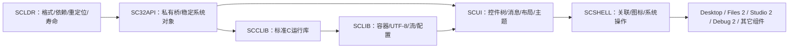

# SandCore M10a2 — The Application Platform Era

2026-10-14 用户授权阅读、严格遵守根 `M10a2RULE.MD` 并开始实际工作；同日正式名称改为本标题。该规则的完整功能范围保留，普通实现、定向构建及验证已有授权。

## 1. 基线与不可退化的合同

开工基线为 `main@8e1c27abfe1b0c14ddff6d23464a961eabfd8cc0`。沿用工作区“以后就一个 main”的规则；不为本轮改写已发布历史。开工时 `.zcodeignore` 和用户提供的 `M10a2RULE.MD` 未跟踪，不把其它用户文件混入开发提交。

M10a1 Preview 是已验收基线，原镜像、运行包、历史 SCX 和用户盘保留。原 M8 的未完成游戏/影片继续封存。M10a2 的组件重制保持其现有可用功能，不以重新编译冻结游戏或重启渲染作为平台建设步骤。

`user/SCAPI.H` 正式冻结，开工 SHA256：`81a730450fcb3d310ed841ad3e5c70a3fed32aa7fbd10acac8b888ac7da9ffc1`。旧系统调用、忽略的寄存器、返回值、固定快照和旧 SCX 不变。新系统 API 通过完全大写的 `SC32API.H` 公开。标准 C 头保留标准小写名称。

新增 SCCLIB 是 Ring 3 标准 C 运行库；内核继续 freestanding、无 libc 和浮点。SCL 与 SKM 不共享权限或信任模型；SCL 不获得 SYSTEM 或 Ring 0 权限。正式签名私钥仍只有用户持有。

## 2. 已审查的架构事实

SCX1 使用 36 字节头、固定 `0x00400000`、最多 `0x003d0000` 映像/BSS及独立栈；尾部图标严格校验。SCCC 的实际实现为 `s3c.c` 与 lex/pp/parse/emit 片段；已有 `F_ABS/F_REL/F_DATA` 回填和 `--skm`，外部符号尚须在单翻译单元内解决。现有 `start.asm` 是引导入口及私有 cdecl 桥。

用户图形堆为 `0x40000000..0x43ffffff`，其它 RAM/MMIO 仍采用 supervisor 恒等别名。扩大 SCX 低地址区会破坏内核在调用者 CR3 下访问物理帧的能力。SCL 使用单独的 `0x50000000..0x53ffffff` 懒分配窗口，第一阶段每进程独立物理页。

开工分页只验证 P/US，未检查 syscall 输出缓冲的 RW，调试复制经物理别名写入。SCL 代码只读前必须接入独立可写校验，输入字符串仍允许只读页；授权断点修补是显式单字节特例。当前非 PAE 分页没有 NX，不声称完整 W^X。

GUI 主要仍以 NUI 源片段和各应用私有控件实现；Files、Studio、Debug 存在重复菜单代码。当前终端入口是 M9 SandShell。保真与迁移清单见 `M10A2-COMPONENT-AUDIT.md`，该清单不替代实际交互验收。

## 3. 依赖与职责

SCLDR 的最小引导实现可静态进入 SCX，但库的正文只能在运行期从独立 SCL 文件装载、重定位和解析。不能复制库正文进程序后宣称动态链接。SC32API 底层保持独立于 SCCLIB；GUI 控件和菜单位于 Ring 3。

SCL v1 二进制合同见 `SCL.md`，运行时合同见 `SCLDR.md`。装载器只保留元数据副本，完成搬运后释放文件正文。段逐页对齐，text/rodata 只读，data/BSS 私有可写；段间填充只读。共享代码页、PIC 和物理引用计数在正确性基础上独立推进，不能套用当前私有页释放规则。

系统库固定从 `/SYS/LIB/` 读取，第三方库从开发者显式指定的绝对包目录读取；不搜索当前目录、环境 PATH 或不受控制的同名文件。库以声明名称和 ABI 识别，包不能替换保留的正式系统库名。文件读取遵守调用进程的 SandFS 权限；用户态库不增加调用进程的资格。

## 4. 完整路线与阶段出口

| 阶段 | 完整实施范围 | 必须有的出口证据 |
|---|---|---|
| Phase 0 | 仓库/组件/编译器/内存与安全审计，二进制/API/视觉规范和验收标准 | 真实源码落点、保真清单、可恢复状态 |
| Phase 1 | SCL v1、SCLDR、启动依赖、显式装载、重定位/导入导出、引用/回滚/清理、SCCC 与检查工具 | 不同装载地址的实际多库调用、错误拒绝、退出/异常回收和隔离 |
| Phase 2 | SC32API.H/SCL，系统对象、窗口消息和私有 syscall 桥 | 新程序不包含 SCAPI.H 即可工作，权限/寿命正确 |
| Phase 3 | SCCLIB 标准语义、分配器/缓冲 I/O/格式化，SCLIB 容器/编码/配置/事件/缓存 | 逐项兼容表、独立预期值、失败与边界及实测成本 |
| Phase 4 | SCUI 控件树、焦点/键鼠/消息、布局/裁剪/脏矩形、菜单/树/表/对话框/编辑、两套主题 | 独立控件示例，真实键鼠/缩放/遮挡/资源及长列表证据 |
| Phase 5 | 桌面图标选择/拖动/持久化、系统剪贴板/拖放、关联/开始菜单/任务栏、Shell 服务 | 真实跨应用和重启操作、权限及会话隔离 |
| Phase 6 | Files 2、Studio 2、Debug 2，逐项重制其余主要组件、历史版本归档 | 每组件既有行为保留、新工作流和统一布局实测 |
| Phase 7 | 官方 SDK、系统内编译链接运行、示例/完整 API 文档、实际优化、最终镜像 | 独立第三方复杂应用闭环、完整功能/视觉/兼容/性能证据 |

先平台再应用。阶段范围不会因引导样例通过而缩减；宿主编译、SCCC 系统内编译和客体执行分别记录。SCCC 当前不支持浮点和 64 位整数，SCCLIB 不添加语义不真实的格式占位。C89/C99 逐项支持范围与 time/locale/math 的分阶段表必须公开。

## 5. 验证规模与结束条件

每个新验证指出具体未解决问题、输入版本和结束条件。首个切片只解决真实两库调用、重定位、模块只读输入/写回拒绝、保护原子性、失败回滚和页回收；宿主模拟回调只证明装载算法，不能证明 i386 代码运行。

Windows QEMU 固定使用软盘引导加 IDE SandFS。新核心只做定向构建，使用已有 M10a1 基盘的一个独立验证副本/适用的覆盖层；不把全部 USER_SCX 或重复双来源矩阵作为每次修复的依赖。有效且未受影响的 M10a1 证据复用，新增行为必须有新证据。阶段提交只包含明确范围内的源码、规范及已验证结果。

GUI 最终必须有实际鼠标、键盘、窗口、文件交互和原尺寸截图。Classic/Aurora 共享行为和布局；颜色继续遵循 GFX 调色板/主题角色。性能记录装载/元数据与物理页、重绘/输入长尾/宿主 CPU，不能把宿主算法或微型测试当整机流畅。

## 修订

2026-10-14：按用户 M10a2 开工授权建立完整平台路线，采用正式名称 The Application Platform Era；冻结旧 API、记录实际地址与编译器约束，首切片尚未客体验证。
