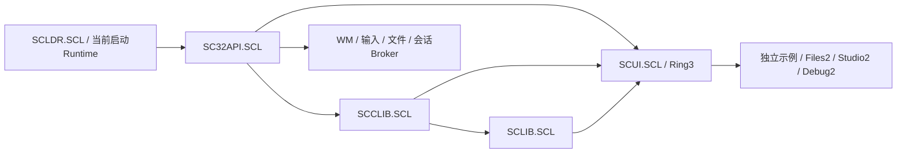

# SCUI 原生控件框架设计

所属版本：**SandCore M10a2 — The Application Platform Era**。范围是根 `M10a2RULE.MD` §4.4、§7、§8、§9 和开发者体验的完整 GUI 框架要求。本文于 2026-10-15 只读设计；**没有 SCUI 实现、导出、构建或运行证据**。Phase 3 的 ROOT/SC32/SCCLIB/SCLIB 正由主代理统一验证，本文不修改它们的冻结输入。P0 多窗证据只证明已列明的平台行为，不证明本框架或完整 M10a2 已完成。

本文中的 `SCUI.H` 声明、SC32 增量及版本号是下一实施批的合同建议，不是当前已经可链接的入口。正式实施时先落公共头、全部实际正文、清单和同步规范，再统一生成和运行。不得发布声明存在而正文为空的库。

## 1. 已读依据与真实底座

| 依据 | 当前可用事实 | 本设计的边界 |
|---|---|---|
| [M10a2RULE.MD](../../M10a2RULE.MD) §4.4/7/8/9 | 完整控件树、菜单、表格、树、对话框、编辑；Classic 一等主题；主要组件复用 | 不以 NUI.inc 动态化、少量按钮或换皮替代框架 |
| [SC32GUI.H](../user/SC32GUI.H)、[SC32-GUI.md](SC32-GUI.md)、[SC32-GUI-USER.md](SC32-GUI-USER.md) | 20 项正式 GUI 入口；64B 消息、96B 精确窗口/输入、64B paint、64B submit；CREATE 两段、modal、capture、真实键通断、局部提交 | 控件、文字和菜单的过程在 Ring3；kernel 不保存控件树 |
| [SC32API.H](../user/SC32API.H) | 当前新源 ABI1.1/v2，86 入口；ScCallbackPin 已实际接线；Theme24 角色、显示 scale、文件对象/目录分页/宽单调时钟 | 新源正在验证；CLIPBOARD/IPC 能力位和 TIMER 常量本身不等于相应 API 已有 |
| [SCLIB.H](../user/sclib/SCLIB.H)、[SCLIB.md](SCLIB.md) | 冻结的 163 项容器、严格 UTF8、模型、事件、cache/lease 正文与清单 | 当前进入统一验证，不复制它的算法；ScModel 是通用模型，不是现成的虚拟表格/编辑器 |
| [GFX.md](GFX.md)、[THEME.md](THEME.md) | 已登记 Classic/Aurora 命名色与24角色、原生ARGB、VGA最后量化 | 不新增裸RGB、不改旧DAC，不通过小尺寸渲染再放大冒称原生清晰 |
| [FONT.md](FONT.md)、[ttf.h](../kernel/ttf.h) | 原 PHOENIX12/16 TTF；bitmap400字，26.6指标，128×96上限，系统字库/缓存归内核 | 字库是用户原字体；不替换字库、不复制ttf解析器到SCUI |
| [ttf.c](../kernel/ttf.c) `ttf_init:217`、`raster:256`、`glyph:308`、`ttf_bitmap:325`、`ttf_info:354` | 原子脸提交、真实字体epoch、整数扫描线、64组×4路缓存、实际advance/baseline/left；只支持这份字体的on-curve非复合配置 | 不是任意TrueType、hint/kerning/复杂脚本整形引擎；缺字不能从另一字库补 |
| [task.c](../kernel/task.c) `SYS_FONTINFO2:1183`/`SYS_GLYPHBITMAP:1185`、[task.h](../kernel/task.h) `0x248/249` | 旧调用确有64B字体信息和1600B字形副本，完整输出写检查 | SC32公开头尚无字体入口；SCUI不得include SCAPI或手写此桥 |
| [gfx.c](../kernel/gfx.c) `clip:26`、`argb_blit:193`、`opaque_blit:233`、`swap_rect:320` | 合成视口、ARGB和opaque行路径、原生矩形上屏；VGA整屏回退 | 这些是内核实现，不是SCUI可直接调用的库导出 |
| [mouse.c](../kernel/mouse.c) `pkt[3]:28`、`mouse_init:115`、`raw_mouse:163`、[keyboard.c](../kernel/keyboard.c) `modern_scan:147` | 三字节PS/2包、三按钮；有序KEYDOWN/UP、ASCII TEXT、导航/功能键与修饰 | 尚无滚轮、I-beam形状、IME；不从快照伪造它们 |

已读完整公共头、上述两个完整字体/绘图正文及输入相关范围。平台所有者仍按现分工维护新gate、raw输入和runtime；本次唯一新文件是本文。

## 2. 依赖、库与责任



SCUI 只动态导入 SC32、SCCLIB、SCLIB；不自行建立第二个runtime，不复制任何库正文进SCX。首版拟 SCUI ABI1.0/library_version1；SCCLIB最低1.0/v1、SCLIB最低1.0/v1，SC32至少1.1/v2以取得真实代码pin。字体/paint cancel/系统剪贴板等增量接线后，清单必须进一步提高到**实际含这些导出的SC32版本**，不得提前写一个虚假的最低版本。只发布真实用到的imports和实际定义的exports；系统库固定从受保护 `/SYS/LIB/` 解析。

SCCLIB负责分配、标准mem/string/stdio/format/qsort；SCLIB负责通用数组/hash/字符串/UTF8/model/event/cache。SCUI新增的是控件状态机、布局、虚拟化、文本编辑事务、菜单和原生绘制，不重写malloc、UTF8解码或配置解析。初版自身有小型控件绘制器；SCGFX/SCRES/SCSHELL完成后可替换内部后端，不能让尚不存在的三个库成为循环引导依赖。

一个正常SCUI应用只需正式公开头和清单。它可混用自己的SC32窗口，但所有进程消息必须由一个消息泵取得，再分派给所属窗口；禁止两个泵争抢队首。SCUI窗过程由库统一安装，应用通过控件事件/命令订阅，不替换其procedure/context。

## 3. 对象、ABI与失败纪律

`ScUiContext`是引用计数的不透明Ring3对象；`ScUiNode`为非零u32稳定编号，属于该context。真实root也有非零编号；普通控件的parent必须活节点，只有WindowCreate不用普通parent。编号单调、不复用，context/generation域耗尽返回RANGE，不改成固定256/512控件或历史节点表。`ScUiNodeInfo`公开值/代数，绝不返回kernel地址。调用者持有context引用；最后Release后的裸context指针不可再调用，代数不能挽救已释放指针。

一棵root的节点有父/子/兄弟链、真实root引用、局部rect/clip、布局与内容revision；hash按ID查找。一个控件不是一个内核窗口。只有独立主窗、真实dialog、必须跨客户边界的popup属于WM。控件disable/hide由祖先资格缓存传播；隐藏/禁用节点不命中、不Tab、不捕获。正常删除叶先O(k)，无递归固定深度、无仅为删节点而扫描全历史ID。

公共ABI为i386 cdecl、4B最低入口对齐；GCC库沿用正式callee对齐规则。所有记录以size/version起首，v1输入精确尺寸、保留位零；输出声明范围须合法，成功写规范前缀，未知tail不改。纯Ring3参数遵守标准C合法本人指针合同，不能宣传为同进程内存沙箱。公开头无inline bridge、asm、int/reg、float或假long long；宽时钟/计数用ScWideCounter。UI持久字符串均明确counted UTF8并复制拥有，临时event/model/provider data只在合同给出的借用期限内有效。

拟 UI 错误域：0成功；1 HANDLED只用于回调；2 VETO只用于可取消before事件；3 END用于枚举；4 PENDING用于异步数据/对话框。负值从-301起：INVALID、VERSION、RANGE、MEMORY、STALE、NOT_FOUND、EXISTS、BUSY、UTF8、IO、CANCELLED、NOT_SUPPORTED、FAILED。独立 `ScUiErrorInfo`保存UI code和cause_code/domain/raw/operation；原SC32/SCLIB/errno不可被全部改成一个“失败”。查询失败保持out，枚举END是明确终态。

所有Create/文本替换/layout设置/菜单树替换/列集合/model绑定/style span/import候选在commit前完成范围、拥有副本、metadata和回调pin。OOM/版本/UTF8/循环关系/布局溢出保留旧内容、容量、有效revision和out。提交后observer失败单独记通知错误，不假称已提交状态回滚。外部文件/剪贴板已经成功提交的副作用只能按真实协议处理，不能用UI对象回滚概念掩盖磁盘前缀写入。

## 4. 正式 SCUI.H：类型与记录

下面是完整首批接口族的头文件方案；数值枚举和结构须在实施批正式冻结、与文档同批落地。所列功能都必须实现，再列入manifest。固定宽度几何原语无版本头；独立请求/结果有版本头。

```c
#ifndef SANDCORE_SCUI_H
#define SANDCORE_SCUI_H
#include "SC32API.H"
#include "SCLIB.H"

enum {
    SC_UI_ABI_MAJOR=1,SC_UI_ABI_MINOR=0,SC_UI_VERSION=1,
    SC_UI_OK=0,SC_UI_HANDLED=1,SC_UI_VETO=2,SC_UI_END=3,SC_UI_PENDING=4,
    SC_UI_E_INVALID=-301,SC_UI_E_VERSION=-302,SC_UI_E_RANGE=-303,
    SC_UI_E_MEMORY=-304,SC_UI_E_STALE=-305,SC_UI_E_NOT_FOUND=-306,
    SC_UI_E_EXISTS=-307,SC_UI_E_BUSY=-308,SC_UI_E_UTF8=-309,
    SC_UI_E_IO=-310,SC_UI_E_CANCELLED=-311,SC_UI_E_NOT_SUPPORTED=-312,SC_UI_E_FAILED=-313,
    SC_UI_WINDOW=1,SC_UI_PANEL=2,SC_UI_BUTTON=3,SC_UI_LABEL=4,
    SC_UI_CHECKBOX=5,SC_UI_RADIO=6,SC_UI_GROUPBOX=7,SC_UI_TEXTBOX=8,
    SC_UI_EDIT=9,SC_UI_COMBOBOX=10,SC_UI_SPINBOX=11,SC_UI_TAB=12,
    SC_UI_TREE=13,SC_UI_LIST=14,SC_UI_MENUBAR=15,SC_UI_TOOLBAR=16,
    SC_UI_STATUS=17,SC_UI_PROGRESS=18,SC_UI_TOOLTIP=19,SC_UI_SCROLL=20,
    SC_UI_SPLITTER=21,SC_UI_DOCK=22,SC_UI_GRID=23,SC_UI_TABLE=24,
    SC_UI_PROPERTY_PAGE=25,SC_UI_CLASS_FIRST=65536,
    SC_UI_VISIBLE=1,SC_UI_ENABLED=2,SC_UI_FOCUSED=4,SC_UI_HOVER=8,
    SC_UI_PRESSED=16,SC_UI_CHECKED=32,SC_UI_MIXED=64,SC_UI_SELECTED=128,
    SC_UI_READONLY=256,SC_UI_INVALID=512,SC_UI_EXPANDED=1024,SC_UI_BUSY=2048,
    SC_UI_FOCUSABLE=1,SC_UI_TABSTOP=2,SC_UI_EDITOR_TAB=4,
    SC_UI_LABEL_SELECTABLE=8,SC_UI_PASSWORD=16,
    SC_UI_STOP_LAST_ROOT=1,SC_UI_SCALE_DISPLAY=0,SC_UI_SCALE_CUSTOM=1,
    SC_UI_TIMER_DRAW_ONLY=1,SC_UI_TIMER_BACKGROUND=2,
    SC_UI_FONT_BODY=0,SC_UI_FONT_DENSE=1,SC_UI_FONT_HEADING=2,SC_UI_FONT_MENU=3,SC_UI_FONT_CODE=4,
    SC_UI_PROGRESS_DETERMINATE=0,SC_UI_PROGRESS_INDETERMINATE=1,
    SC_UI_DRAG_COPY=1,SC_UI_DRAG_MOVE=2,
    SC_UI_ABSOLUTE=0,SC_UI_HBOX=1,SC_UI_VBOX=2,SC_UI_DOCK_LAYOUT=3,
    SC_UI_GRID_LAYOUT=4,SC_UI_FLOW=5,SC_UI_OVERLAY=6,SC_UI_SCROLL_LAYOUT=7,
    SC_UI_AUTO=-1,SC_UI_START=0,SC_UI_CENTER=1,SC_UI_END_ALIGN=2,SC_UI_STRETCH=3,
    SC_UI_CAPTURE_PHASE=1,SC_UI_TARGET_PHASE=2,SC_UI_BUBBLE_PHASE=4,
    SC_UI_EVENT_DEVICE=1,SC_UI_EVENT_PROGRAMMATIC=2,SC_UI_EVENT_CANCELABLE=4,
    SC_UI_MENU_SEPARATOR=1,SC_UI_MENU_DISABLED=2,SC_UI_MENU_CHECKED=4,
    SC_UI_MENU_RADIO=8,SC_UI_MENU_DEFAULT=16,
    SC_UI_PROVIDER_SORT=1,SC_UI_PROVIDER_EDIT=2,SC_UI_PROVIDER_TREE=4,SC_UI_PROVIDER_ASYNC=8,
    SC_UI_DATA_COUNT=1,SC_UI_DATA_CHILD_COUNT=2,SC_UI_DATA_CHILD_AT=3,
    SC_UI_DATA_ITEM=4,SC_UI_DATA_CELL=5,SC_UI_DATA_INDEX_OF=6,
    SC_UI_DATA_SORT=7,SC_UI_DATA_COMMIT_EDIT=8,
    SC_UI_SELECTION_MULTI=1,SC_UI_SELECTION_ALLOW_EMPTY=2,
    SC_UI_REPLACE=0,SC_UI_ADD=1,SC_UI_REMOVE=2,SC_UI_TOGGLE=3,
    SC_UI_EVENT_CREATE=1,SC_UI_EVENT_DESTROY=2,SC_UI_EVENT_FOCUS_IN=3,SC_UI_EVENT_FOCUS_OUT=4,
    SC_UI_EVENT_KEY_DOWN=5,SC_UI_EVENT_KEY_UP=6,SC_UI_EVENT_TEXT=7,
    SC_UI_EVENT_POINTER_ENTER=8,SC_UI_EVENT_POINTER_LEAVE=9,SC_UI_EVENT_POINTER_MOVE=10,
    SC_UI_EVENT_POINTER_DOWN=11,SC_UI_EVENT_POINTER_UP=12,SC_UI_EVENT_WHEEL=13,
    SC_UI_EVENT_CAPTURE_LOST=14,SC_UI_EVENT_COMMAND=15,
    SC_UI_EVENT_VALUE_CHANGING=16,SC_UI_EVENT_VALUE_CHANGED=17,
    SC_UI_EVENT_SELECTION_CHANGING=18,SC_UI_EVENT_SELECTION_CHANGED=19,
    SC_UI_EVENT_OPENING=20,SC_UI_EVENT_CLOSING=21,SC_UI_EVENT_CLOSE_REQUEST=22,
    SC_UI_EVENT_LAYOUT=23,SC_UI_EVENT_PAINT=24,SC_UI_EVENT_TIMER=25,
    SC_UI_EVENT_MODEL_CHANGED=26,SC_UI_EVENT_ERROR=27,SC_UI_EVENT_COMMAND_QUERY=28,
    SC_UI_EVENT_DIALOG_COMPLETE=29,SC_UI_EVENT_VALIDATE=30,SC_UI_EVENT_APPLY=31,
    SC_UI_EVENT_DRAG_ENTER=32,SC_UI_EVENT_DRAG_OVER=33,SC_UI_EVENT_DRAG_LEAVE=34,
    SC_UI_EVENT_DROP=35,SC_UI_EVENT_INPUT_SYNC=36,SC_UI_EVENT_USER=32768
};

typedef struct ScUiContext ScUiContext;
typedef struct ScUiPainter ScUiPainter;
typedef struct ScUiMenu ScUiMenu;
typedef struct ScUiProvider ScUiProvider;
typedef struct ScUiSelection ScUiSelection;
typedef struct ScUiDocument ScUiDocument;
typedef struct ScUiDialog ScUiDialog;
typedef struct ScUiIcon ScUiIcon;
typedef ScU32 ScUiNode;
typedef ScU32 ScUiClass;

typedef struct {ScI32 x,y,width,height;} ScUiRect;
typedef struct {ScI32 width,height;} ScUiSize;
typedef struct {ScU32 size,version;const char *data;ScU32 bytes;} ScUiText;
typedef struct {ScU32 size,version,key,modifiers;} ScUiShortcut;

typedef struct {
    ScU32 size,version,type,phase,flags,node,current,root,command,tick,input_epoch;
    ScI32 x,y;ScU32 key,scalar,modifiers,buttons;
    const ScMessage *message;const void *data;ScU32 bytes;
    ScWideCounter sequence;ScU32 reserved[2];
} ScUiEvent;
typedef ScStatus (*ScUiEventProc)(ScUiContext *,const ScUiEvent *,void *);

typedef struct {
    ScU32 size,version,flags,cache_budget_bytes,undo_budget_bytes,scheduling_quantum;
    ScU32 default_font_face,default_font_pixels,scale_mode,scale_percent;
    ScUiEventProc error_procedure;void *context;ScU32 reserved[4];
} ScUiContextDesc;
typedef struct {
    ScU32 size,version;ScUiText title;ScI32 x,y;
    ScU32 client_width,client_height,style,owner;
    void *context;ScDropProc context_drop;ScU32 reserved[2];
} ScUiWindowDesc;
typedef struct {
    ScU32 size,version,kind,parent,command,flags;ScUiText text;
    void *context;ScDropProc context_drop;ScU32 reserved[4];
} ScUiWidgetDesc;
typedef struct {
    ScU32 size,version,node,generation,kind,parent,first_child,next_sibling;
    ScU32 root,native_window,state,flags;ScUiRect rectangle,clip;
    ScU32 value_revision,layout_revision,font_role,reserved;
} ScUiNodeInfo;
typedef struct {
    ScU32 size,version,mode,flags;
    ScI32 left,top,width,height,min_width,min_height,max_width,max_height;
    ScU32 flex_weight,dock;ScI32 margin[4],padding[4];
    ScU32 gap,columns,column,row,column_span,row_span,align_h,align_v,reserved[2];
} ScUiLayoutDesc;
typedef struct {
    ScU32 size,version,type,phases;ScI32 priority;
    ScUiEventProc procedure;void *context;ScDropProc context_drop;
    ScU32 flags,reserved[3];
} ScUiSubscription;
typedef struct {
    ScU32 size,version,nodes,roots,timers,listeners,layout_revision;ScI32 notification_error;
    ScU32 surface_bytes,cache_bytes,dirty_roots,visible_roots;
    ScWideCounter received_messages,paint_count,submitted_bytes;ScU32 reserved[2];
} ScUiContextInfo;
typedef struct {
    ScU32 size,version;ScI32 code,cause_code;ScU32 domain;ScI32 raw;
    ScU32 operation,node,revision,reserved[3];
} ScUiErrorInfo;
typedef struct {
    ScU32 size,version,scale_percent,font_face,font_pixels,font_epoch,theme_epoch,display_epoch;
    ScU32 unit,row_height,menu_height,toolbar_height,status_height,gap,splitter,border;
} ScUiMetrics;
typedef struct {
    ScU32 size,version,node,flags;ScWideCounter deadline;
    ScU32 period_ticks,reserved;
} ScUiTimerDesc;
typedef struct {
    ScU32 size,version,width,height,lines,baseline,generation,missing_glyphs;
} ScUiTextMetrics;
typedef struct {
    ScU32 size,version,width,height,format,flags,revision,bytes;
} ScUiIconInfo;

typedef ScStatus (*ScUiMeasureProc)(ScUiContext *,ScUiNode,const ScUiSize *,ScUiSize *,void *);
typedef ScStatus (*ScUiArrangeProc)(ScUiContext *,ScUiNode,const ScUiRect *,void *);
typedef ScStatus (*ScUiPaintProc)(ScUiContext *,ScUiNode,ScUiPainter *,void *);
typedef struct {
    ScU32 size,version,flags;const char *name;
    ScUiMeasureProc measure;ScUiArrangeProc arrange;ScUiPaintProc paint;
    ScUiEventProc event;void *context;ScDropProc context_drop;ScU32 reserved[6];
} ScUiClassDesc;
```

上述v1尺寸：Text16、Shortcut16、Event96、ContextDesc64、WindowDesc64、WidgetDesc64、NodeInfo96、Layout128、Subscription48、ContextInfo80、ErrorInfo48、Metrics64、Timer32、TextMetrics32、IconInfo32、ClassDesc64。`kind`为builtin类别或ClassRegister返回的注册类别；内置/自定义编号域分开并公开枚举，不用应用约定的魔数伪装扩展。

Builtin必须涵盖 WINDOW/PANEL、BUTTON/LABEL/CHECKBOX/RADIO/GROUPBOX、TEXTBOX/EDIT/COMBOBOX/SPINBOX、TAB/TREE/LIST、MENUBAR/TOOLBAR/STATUS/PROGRESS/TOOLTIP、SCROLL/SPLITTER/DOCK/GRID/TABLE/PROPERTY_PAGE/CUSTOM。菜单popup与各dialog用独立对象族，不能把上述每项映射为普通Button。

State明确VISIBLE/ENABLED/FOCUSED/HOVER/PRESSED/CHECKED/MIXED/SELECTED/READONLY/INVALID/EXPANDED/BUSY；desired状态和祖先effective状态分别查询。事件至少CREATE/DESTROY、FOCUS_IN/OUT、KEY_DOWN/UP/TEXT、POINTER_ENTER/LEAVE/MOVE/DOWN/UP/WHEEL、CAPTURE_LOST、COMMAND、VALUE_CHANGING/CHANGED、SELECTION_CHANGING/CHANGED、OPENING/CLOSING、CLOSE_REQUEST、LAYOUT、PAINT、TIMER、MODEL_CHANGED、ERROR；capture/target/bubble阶段为显式枚举。

## 5. 正式入口：context、树、布局、输入与绘制

```c
ScStatus ScUiContextCreate(const ScUiContextDesc *,ScUiContext **out);
ScStatus ScUiContextRetain(ScUiContext *);
void ScUiContextRelease(ScUiContext *);
ScStatus ScUiContextQuery(const ScUiContext *,ScUiContextInfo *out);
ScStatus ScUiErrorQuery(const ScUiContext *,ScUiErrorInfo *out);
ScStatus ScUiContextStop(ScUiContext *,ScI32 exit_code);
ScStatus ScUiContextRun(ScUiContext *,ScI32 *exit_code);
ScStatus ScUiContextStep(ScUiContext *,ScU32 timeout_ticks);
ScStatus ScUiContextDispatch(ScUiContext *,const ScMessage *);
ScStatus ScUiWindowCreate(ScUiContext *,const ScUiWindowDesc *,ScUiNode *out);
ScStatus ScUiWindowNative(ScUiContext *,ScUiNode,ScWindowInfo *out);
ScStatus ScUiWindowShow(ScUiContext *,ScUiNode,ScU32 action);
ScStatus ScUiWindowSetTitle(ScUiContext *,ScUiNode,const ScUiText *);
ScStatus ScUiWidgetCreate(ScUiContext *,const ScUiWidgetDesc *,ScUiNode *out);
ScStatus ScUiNodeDestroy(ScUiContext *,ScUiNode);
ScStatus ScUiNodeQuery(const ScUiContext *,ScUiNode,ScUiNodeInfo *out);
ScStatus ScUiNodeMove(ScUiContext *,ScUiNode,ScUiNode parent,ScUiNode before);
ScStatus ScUiNodeSetState(ScUiContext *,ScUiNode,ScU32 mask,ScU32 value);
ScStatus ScUiNodeSetText(ScUiContext *,ScUiNode,const ScUiText *);
ScStatus ScUiNodeCopyText(ScUiContext *,ScUiNode,ScString **out);
ScStatus ScUiNodeSetValue(ScUiContext *,ScUiNode,const ScValue *);
ScStatus ScUiNodeGetValue(ScUiContext *,ScUiNode,ScValue *out);
ScStatus ScUiNodeSetIcon(ScUiContext *,ScUiNode,ScUiIcon *);
ScStatus ScUiNodeSetFont(ScUiContext *,ScUiNode,ScU32 font_role);
ScStatus ScUiNodeSetLayout(ScUiContext *,ScUiNode,const ScUiLayoutDesc *);
ScStatus ScUiNodeGetLayout(ScUiContext *,ScUiNode,ScUiLayoutDesc *out);
ScStatus ScUiLayout(ScUiContext *,ScUiNode root);
ScStatus ScUiBatchBegin(ScUiContext *);
ScStatus ScUiBatchEnd(ScUiContext *);
ScStatus ScUiInvalidate(ScUiContext *,ScUiNode,const ScUiRect *local);
ScStatus ScUiEnsureVisible(ScUiContext *,ScUiNode,const ScUiRect *local);
ScStatus ScUiFocus(ScUiContext *,ScUiNode);
ScStatus ScUiFocusQuery(const ScUiContext *,ScUiNode root,ScUiNode *out);
ScStatus ScUiFocusNext(ScUiContext *,ScUiNode root,ScI32 direction);
ScStatus ScUiCapture(ScUiContext *,ScUiNode,ScU32 enabled);
ScStatus ScUiHitTest(const ScUiContext *,ScUiNode root,ScI32 x,ScI32 y,ScUiNode *out);
ScStatus ScUiListen(ScUiContext *,ScUiNode,const ScUiSubscription *,ScU32 *token);
ScStatus ScUiDisconnect(ScUiContext *,ScU32 token);
ScStatus ScUiCommand(ScUiContext *,ScUiNode source,ScU32 command);
ScStatus ScUiTimerSet(ScUiContext *,const ScUiTimerDesc *,ScU32 *token);
ScStatus ScUiTimerChange(ScUiContext *,ScU32 token,const ScUiTimerDesc *);
ScStatus ScUiTimerCancel(ScUiContext *,ScU32 token);
ScStatus ScUiTimerQuery(ScUiContext *,ScU32 token,ScUiTimerDesc *out);
ScStatus ScUiMetricsQuery(ScUiContext *,ScUiNode root,ScUiMetrics *out);
ScStatus ScUiMeasureText(ScUiContext *,ScU32 font_role,const ScUiText *,ScI32 width,ScU32 flags,ScUiTextMetrics *out);
ScStatus ScUiClassRegister(ScUiContext *,const ScUiClassDesc *,ScUiClass *out);
ScStatus ScUiClassUnregister(ScUiContext *,ScUiClass);
ScStatus ScUiPainterClip(ScUiPainter *,const ScUiRect *);
ScStatus ScUiPainterRestore(ScUiPainter *);
ScStatus ScUiPainterFill(ScUiPainter *,const ScUiRect *,ScU32 color_role);
ScStatus ScUiPainterLine(ScUiPainter *,ScI32 x1,ScI32 y1,ScI32 x2,ScI32 y2,ScU32 color_role);
ScStatus ScUiPainterText(ScUiPainter *,const ScUiRect *,const ScUiText *,ScU32 font_role,ScU32 flags);
ScStatus ScUiPainterIcon(ScUiPainter *,const ScUiRect *,ScUiIcon *,ScU32 state);
ScStatus ScUiIconCreateArgb(ScU32 width,ScU32 height,ScU32 stride,const ScU32 *pixels,ScUiIcon **out);
ScStatus ScUiIconLoad(ScUiContext *,const char *path,ScUiIcon **out);
ScStatus ScUiIconRetain(ScUiIcon *);
void ScUiIconRelease(ScUiIcon *);
ScStatus ScUiIconQuery(const ScUiIcon *,ScUiIconInfo *out);
```

`BatchBegin/End`只合并layout/invalidate/通知时机，不承诺撤销已经成功的独立Set；需要批量候选的菜单/列/文档操作有各自原子接口。Rect半开，越界先求交、空交集不绘不命中，乘加溢出明确RANGE。Painter只在当前paint callback期间有效，使用栈/深度保护的clip，不返回可长期缓存的像素地址。IconCreate复制拥有实际ARGB；IconLoad首版真正支持SCB2/SCB1/SCF自身资产并严格校验，PNG/JPEG/WebP须经未来正式SC32图像服务接口接入，不能把转SCB工具称运行时解码。

NodeInfo.rectangle/clip为root客户物理坐标；Pointer Event x/y为本次current节点局部物理坐标，original ScMessage保留root坐标。HitTest(root)用root客户物理坐标，View/EditHitTest(node)用node局部物理坐标；measure/arrange回调、Painter与Metrics均给实际物理像素，只有LayoutDesc的声明长度是96基准逻辑值。read-only View/value/CommandQuery中的data指针借到对应对象下一修改/Release，CopyText/DocumentCopy/SelectedPath返回拥有对象并由调用者Release。UI标题再完整复制为系统NUL字符串，保持SC32127B/控制字符/严格UTF8限制。

ClassRegister把measure/arrange/paint/event/drop全部先PinCallback，候选齐后提交；注册类别有活节点时Unregister为BUSY。测量/绘制回调中删除本节点、换model或释放context允许退役；外层持有depth并在回调返回重新核ID/revision，不能继续解旧children/data。自定义控件服从同一clip、焦点、命中、可访问状态和生命周期，不能获得WM/SYSTEM特权。

WindowCreate在真正SC32 CREATING回调内建立root/子控件及实际尺寸layout，UI CREATE事件的node是候选稳定ID，可添加孩子；HANDLED视为接受，VETO或负错误转构造拒绝。最终Activate前重验out及所有候选；外层拒绝会退役已公布给CREATE回调的临时孩子并恰好一次Destroy，不让它们在失败窗口下继续活。库init不急建UI或在loader busy时登记callback，ContextCreate从应用正常运行状态懒建立实例。

## 6. 控件树、布局与真实生产尺寸

布局采用measure→arrange候选，而不是每次paint重新计算。AUTO=-1，非负固定逻辑尺寸；min>=0、max=-1或>=min。支持absolute、横/纵box、dock、grid（跨度）、flow、overlay和scroll；stretch/center/start/end明确。所有逻辑长度为96基准的整数，物理边界以 `floor(logical*scale_percent/100)` 在同一parent坐标系转换；先用检查过的分解乘除防u32/i32溢出。兄弟共享边界由同一累计值得到，150%不会留一像素缝或重叠；flex余数按稳定顺序分配。

measure含Phoenix真实字宽、ascent/descent、边框/内边距；文本改变只失效受影响祖先的intrinsic链。arrange把所有新rect/clip和hit-index作为候选，任何回调错误、OOM、递归修改或revision改变都保留旧发布layout。mutation由代数标记重新排程，一轮只推进有限工作，不能因callback不断Invalidate而无限布局。图形root缩放来自显示，不把缩放后的输入坐标再除两遍。

root的命中先查popup/modal资格，再按同一clip、z和paint顺序查子树；宽面板以分组边界拒绝，无逐鼠标全树重排。长表/树的行命中是viewport→行前缀查找→列边界查找，只访问可见项。普通小控件树可线性扫描该容器的孩子，达到实际成本再增加局部区间/网格index，不在每个label上无意义分配全局空间树。

默认100%字体body/menu为Phoenix16原生，dense/status为Phoenix12原生；以真实行框+4得行高，不能把12脸完整下降区硬裁成12。默认菜单24、工具栏32、状态栏24、输入26、button26、gap6、group外距8、splitter4、icon16，均是逻辑px。Classic同样满足文字行框，compact由style metrics明确决定，不能通过暗压字号显示更多内容。150/200%向系统请求对应实际字号24/32、18/24重新栅格，不放大旧整幅客户图。

| 产品模板（客户区） | 实際控件布局 | 最小宽度/收窄策略 |
|---|---|---|
| Files2 900×560 | Menu24 + Tool32 + Address28；body452：Tree200/分割4/Table696；Status24 | 640宽时Tree160、表剩余；非必要列水平滚动，地址可滚动；不删文件操作 |
| Studio2 1100×680 | Menu24 + Tool32；body600：项目Tree208/分割4/Dock888；编辑tab24/文档416/分割4/输出156；Status24 | 720宽时Tree180；输出是可停靠panel并可主动折叠；多文件/编译/错误导航保留 |
| Debug2 1000×620 | Menu24 + Tool32；body540：左寄存器/断点220，右反汇编/内存/栈dock776，分割4；Status24 | 700宽后右区tab与scroll，地址栏与运行状态始终可见 |
| 对话框 480×320 | 主内容margin12，label列112/input列余量；group gap8；底buttons按Cancel/主动作顺序靠右，button min80、gap8 | 从owner/工作区居中，超小设备内容ScrollView；Esc/Enter仍能完成/取消 |

这些是具体实施起点，最终尺寸从真实Query客户区/字体计算；WM可能裁工作区，不写死屏幕坐标。root名、主动作、数据区、反馈区各有可辨识层次；不会把稀疏卡片堆到一屏只剩少量功能。屏幕320×200保持原设备/旧程序；新框架用紧凑布局、scroll和分步dialog访问全部功能，不声称900px布局可原样塞进VGA。

## 7. 输入、命令、焦点和重入

只消费真实ScMessage。KEYDOWN处理导航/快捷键/助记符，TEXT处理插入可打印Unicode标量；不能在KEYDOWN与TEXT各插一次。符号是当前键盘未shift的逻辑key，组合快捷键用modifiers匹配；Alt助记符在KEYDOWN匹配，因为已有raw对Alt/Ctrl不产生正文。Tab/Shift+Tab在当前root/modal焦点域按tab-order走；disabled/hidden/非focusable跳过，group可指定tabstop，radio组只一个Tab位并由箭头切换。TabControl Ctrl+Tab切页，页内Tab继续控件；Edit接受Tab需显式EDITOR_TAB，Ctrl+Tab仍离开其domain。

真实WM focus和控件focus分别保存。root失焦可以保留逻辑焦点用于恢复，但effective焦点清除、pressed/caret/hover/drag和capture资格撤销；不得A/B同pid共用一个focused状态。进入modal记owner的原焦点ID/代数，结束只恢复仍活且有资格的节点。当前dialog的Tab不穿出owner；Esc取消，Enter执行default button，只有控件未消费Enter才执行dialog默认。

输入传播先snapshot稳定祖先ID链：capture→target→bubble，每次回调返回重验节点与root。HANDLED停止传播，VETO仅在可取消before事件有效，负值记录真实错误。新listener不加入本次旧入口水位，disconnect/销节点立即失效但depth归零后free；事件payload只借到回调返回。所有持久应用callback和drop在登记前pin实际代码域，OOM/pin失败不改原订阅或归属。

Listen的node0仅是context级订阅（USER/ERROR/输入同步），不是可操作的root；其它树/布局/状态入口仍拒绝node0。ContextDispatch只接调用方从正式消息队列取得的记录，source flags不作为跨进程授权证明；同进程调用方本来可破坏自己的内存，库不能宣称阻止手工捏造R3参数。ContextStep只有一个消息消费者，未知属于其它context/原生窗的消息通过ScMessageDispatch交真正procedure，process级USER由context订阅处理，不能静默丢掉其它窗消息。deadline到期发的是SCUI事件TIMER，不向内核POST伪造SC32_MSG_TIMER。

命令ID是应用值，Menu/Toolbar/Button/Shortcut执行同一ScUiCommand链；enabled/checked由同一command state供所有呈现读取，不让工具栏和菜单各保留一份冲突状态。COMMAND携source节点ID和真实输入来源信息，后台post只为本进程应用命令，不能伪装硬件KEY、FOCUS或系统身份。鼠标双击由同target/按钮、真实tick和位移门槛形成控件通知，不伪造新的内核BUTTONDOWN。

capture属于真实root窗口，控件内部仅一个captured节点。真实DOWN先成功取得ScPointerCapture，再开始选择/分割/滚动thumb；失败不进入drag。真实UP结束，CAPTURELOST/QUEUELOSS/Escape/hide/disabled撤状态，不凭快照“补发UP”。QUEUELOSS可重查ScInputSnapshot建立当前事实，但旧动作始终取消，按住repeat不得复活拖动。菜单/tooltip/双击阈值、caret blink和scroll repeat由本进程动态deadline最小堆驱动ScMessageGet有限等待；无期限时无限等待，不持续poll。隐藏绘图timer停画/移出激活堆，后台工作timer仍推进模型；周期按原deadline推进并合并missed，不无限补发。

root CLOSE转可取消CLOSE_REQUEST：VETO或应用接管异步保存确认，库明确ScWindowRejectClose清closing；未处理则Destroy单root。保存dialog成功再显式Destroy，失败/取消保持原root，不能留下已消费而永久closing的窗口。默认“最后root关闭就退出Run”是context可选策略，后台应用可以继续。任何callback不能由框架隐式KernelExit；Run返回后应用正常main return/标准exit。

## 8. 标准控件、数据提供者与完整菜单定义

所有builtin有独立状态机、measure/arrange/paint/input与可访问role；不是只给Create几个kind值。文本、tooltip、icon和command由公共对象引用，无各应用绘制复制。

| 控件 | 必须实现的行为 |
|---|---|
| Button/Label | 文本/icon布局、助记符label关联、Space按下/真实UP执行、default按钮；Label可选择文字但默认不占Tab |
| Checkbox/Radio/GroupBox | 2/3态check、radio同组互斥/箭头；凸凹框与caption基线；disabled不改变值，readonly仍可焦点读取 |
| TextBox/Edit | 共用Document，单行过滤换行、多行scroll/wrap、UTF8选择/鼠标capture、快捷键、Undo/Redo；密码状态不暴露正文可访问值/Copy |
| ComboBox/SpinBox | 可编辑/只读combo、真实下拉popup、键盘上下/Enter/Esc；Spin有checked i32 min/max/step、空值/非法输入验证，不隐式溢出 |
| TabControl | 动态页、active/disabled、Ctrl+Tab、左右键、可溢出页签滚动；非当前页隐藏且停画，模型仍在 |
| Tree/List/Table | provider+稳定item ID、单/多选、range/control选择、type-ahead、行/列hit、按可见区绘制；展开/列resize/sort/编辑通知 |
| MenuBar/ContextMenu/Submenu/Toolbar | 单一Menu/Command定义；popup chain、separator、enabled/checked/radio/icon/shortcut、上下/左右/Esc/Enter/助记符；toolbar overflow复用同命令 |
| Status/Progress/Tooltip | 动态status分区、tooltip延迟/取消与无focus popup；progress确定/不确定模式、隐藏停止动画，文字不能只用颜色传状态 |
| Scroll/Splitter/Dock/Grid | 横竖scrollbar/drag thumb/键盘/Page/Home/End/真正wheel；split min/max与双击恢复；dock可停靠/浮窗/调整、布局配置可保存 |
| MessageBox/FileDialog/PropertySheet | 正常owner modal、键盘默认/取消、权限/过滤/完整分页、验证反馈/Apply/Cancel；取消不改应用文档 |

### 8.1 Provider和selection：不把所有记录变成节点

Table/Tree/List可绑定ScModel的内建adapter，也可绑定应用provider。后者返回真实count、stable ID、children/cell、revision，适合大目录、编译诊断和调试内存；SCUI只缓存可见行附近的数据，不为10万项建10万个Label。固定64行只是一次查询/绘制服务预算，不是内容截断。provider无数据或后台加载时返回PENDING，SCUI显示真正BUSY状态；完成必须Notify，不能静默猜整个数据集已就绪。

```c
typedef struct {
    ScU32 size,version,operation,revision,parent,item,index,column,field,flags,reserved[2];
} ScUiDataRequest;
typedef struct {
    ScU32 size,version,revision,total,item,parent,state;ScUiIcon *icon;ScValue value;
} ScUiDataReply;
typedef ScStatus (*ScUiDataProc)(void *context,const ScUiDataRequest *,ScUiDataReply *);
typedef struct {
    ScU32 size,version,flags;ScUiDataProc procedure;void *context;
    ScDropProc context_drop;ScU32 reserved[2];
} ScUiProviderDesc;
typedef struct {
    ScU32 size,version,revision,kind,parent,first,count,item,field,flags,reserved[2];
} ScUiDataChange;
typedef struct {
    ScU32 size,version,column,flags;ScUiText title;
    ScI32 width,min_width,max_width;ScU32 field,format,sort_kind,reserved[2];
} ScUiColumnDesc;
typedef struct {
    ScU32 size,version,count,current,anchor,revision,flags,reserved;
} ScUiSelectionInfo;
typedef struct {
    ScU32 size,version;ScWideCounter x,y,content_width,content_height;
    ScU32 viewport_width,viewport_height,line_step_x,line_step_y,flags,reserved;
} ScUiScrollInfo;
typedef struct {
    ScU32 size,version,part,flags;ScI32 width;ScUiText text;
    ScUiIcon *icon;ScU32 reserved[2];
} ScUiStatusPart;

ScStatus ScUiProviderCreate(const ScUiProviderDesc *,ScUiProvider **out);
ScStatus ScUiProviderFromModel(ScModel *,ScUiProvider **out);
ScStatus ScUiProviderRetain(ScUiProvider *);
void ScUiProviderRelease(ScUiProvider *);
ScStatus ScUiProviderNotify(ScUiProvider *,const ScUiDataChange *);
ScStatus ScUiViewBind(ScUiContext *,ScUiNode,ScUiProvider *,ScUiSelection *);
ScStatus ScUiViewUnbind(ScUiContext *,ScUiNode);
ScStatus ScUiViewRefresh(ScUiContext *,ScUiNode,ScU32 revision);
ScStatus ScUiSelectionCreate(ScUiProvider *,ScU32 flags,ScUiSelection **out);
ScStatus ScUiSelectionRetain(ScUiSelection *);
void ScUiSelectionRelease(ScUiSelection *);
ScStatus ScUiSelectionQuery(const ScUiSelection *,ScUiSelectionInfo *out);
ScStatus ScUiSelectionSet(ScUiSelection *,ScU32 item,ScU32 action);
ScStatus ScUiSelectionRange(ScUiSelection *,ScU32 first,ScU32 last,ScU32 action);
ScStatus ScUiSelectionClear(ScUiSelection *);
ScStatus ScUiSelectionCopy(const ScUiSelection *,ScArray **item_ids);
ScStatus ScUiTableSetColumns(ScUiContext *,ScUiNode,const ScUiColumnDesc *,ScU32 count);
ScStatus ScUiTableSetColumnWidth(ScUiContext *,ScUiNode,ScU32 column,ScI32 width);
ScStatus ScUiTableSort(ScUiContext *,ScUiNode,ScU32 column,ScU32 descending);
ScStatus ScUiTableBeginEdit(ScUiContext *,ScUiNode,ScU32 item,ScU32 column);
ScStatus ScUiTableEndEdit(ScUiContext *,ScUiNode,ScU32 commit);
ScStatus ScUiTreeExpand(ScUiContext *,ScUiNode,ScU32 item,ScU32 expanded);
ScStatus ScUiViewEnsureItem(ScUiContext *,ScUiNode,ScU32 item);
ScStatus ScUiViewHitTest(ScUiContext *,ScUiNode,ScI32 x,ScI32 y,ScU32 *item,ScU32 *column);
ScStatus ScUiScrollQuery(ScUiContext *,ScUiNode,ScUiScrollInfo *out);
ScStatus ScUiScrollTo(ScUiContext *,ScUiNode,const ScWideCounter *x,const ScWideCounter *y);
ScStatus ScUiSplitterSet(ScUiContext *,ScUiNode,ScI32 position);
ScStatus ScUiDockMove(ScUiContext *,ScUiNode panel,ScUiNode host,ScU32 dock);
ScStatus ScUiDockFloat(ScUiContext *,ScUiNode panel,const ScUiWindowDesc *,ScUiNode *root);
ScStatus ScUiLayoutSave(ScUiContext *,ScUiNode root,ScConfig *);
ScStatus ScUiLayoutRestore(ScUiContext *,ScUiNode root,const ScConfig *);
ScStatus ScUiButtonSetDefault(ScUiContext *,ScUiNode root,ScUiNode button);
ScStatus ScUiLabelAssociate(ScUiContext *,ScUiNode label,ScUiNode target);
ScStatus ScUiCheckSet(ScUiContext *,ScUiNode,ScU32 checked);
ScStatus ScUiRadioSelect(ScUiContext *,ScUiNode group,ScUiNode radio);
ScStatus ScUiSpinRange(ScUiContext *,ScUiNode,ScI32 minimum,ScI32 maximum,ScI32 step);
ScStatus ScUiTabAdd(ScUiContext *,ScUiNode tabs,ScUiNode page,const ScUiText *title);
ScStatus ScUiTabSelect(ScUiContext *,ScUiNode tabs,ScUiNode page);
ScStatus ScUiComboOpen(ScUiContext *,ScUiNode,ScU32 open);
ScStatus ScUiProgressSet(ScUiContext *,ScUiNode,ScU32 value,ScU32 total,ScU32 mode);
ScStatus ScUiStatusSetParts(ScUiContext *,ScUiNode,const ScUiStatusPart *,ScU32 count);
ScStatus ScUiTooltipSet(ScUiContext *,ScUiNode,const ScUiText *);
```

DataRequest48/DataReply64/ProviderDesc32/DataChange48/Column64/SelectionInfo32/ScrollInfo64/StatusPart48。operation包括COUNT、CHILD_COUNT、CHILD_AT、ITEM、CELL、INDEX_OF、SORT、COMMIT_EDIT；provider每次返回同一真实revision。借用value.data和icon必须由provider保持到下一次provider调用/Notify，不能指向已返回的栈；库立即复制需要保留的文本、Retain合法Icon对象。此callback只在Ring3，有重入depth；模型变化使当前行候选失效，读取不会发布混合代数行。

内建ScModel adapter使用 `label`、`enabled`、`icon`、按field指定的typed属性；虚拟root0不是可选择项。选择用stable item ID，sort只改变order，不把第4行当永远同文件。range以本次provider显示顺序生成拥有ID集；删除通知删失效ID、保持仍活current/anchor；所有相关view共享一个Selection而非复制状态。全选可以用“本revision全部+例外ID”表示，再由明确Copy按需枚举，不能无缘无故用数十万Set反复通知。

固定行高列表以除法O(1)求可见范围；变高行用分块前缀索引，只测必要block。树维护expanded分支的可见序列/计数，不每mousemove全DFS；异步展开保留旧序列，加载失败给节点错误状态。列宽候选裁min/max，drag只损伤受影响表区；排序由provider真正执行或内建adapter构造完整新order，失败旧order/selection保持，不能只改变表头箭头。排序较重时按批提取keys并让出，稳定排序的相等键用原位置；默认UTF8字节序、typed数值比较明确，不宣称locale collation。

### 8.2 单一菜单对象与命令状态

```c
typedef struct {
    ScU32 size,version,item,command,flags;ScUiText label;
    ScUiIcon *icon;ScUiMenu *submenu;ScUiShortcut shortcut;ScUiText help;
    void *context;ScDropProc context_drop;ScU32 reserved[3];
} ScUiMenuItem;
typedef struct {
    ScU32 size,version,command,flags;ScUiText label;ScUiShortcut shortcut;
    ScUiIcon *icon;ScU32 reserved[3];
} ScUiCommandDesc;
ScStatus ScUiMenuCreate(ScUiMenu **out);
ScStatus ScUiMenuRetain(ScUiMenu *);
void ScUiMenuRelease(ScUiMenu *);
ScStatus ScUiMenuQuery(const ScUiMenu *,ScContainerInfo *out);
ScStatus ScUiMenuGet(const ScUiMenu *,ScU32 item,ScUiMenuItem *out);
ScStatus ScUiMenuReplace(ScUiMenu *,const ScUiMenuItem *,ScU32 count);
ScStatus ScUiMenuInsert(ScUiMenu *,ScU32 before,const ScUiMenuItem *,ScU32 *item);
ScStatus ScUiMenuRemove(ScUiMenu *,ScU32 item);
ScStatus ScUiMenuSetState(ScUiMenu *,ScU32 item,ScU32 mask,ScU32 state);
ScStatus ScUiMenuSetText(ScUiMenu *,ScU32 item,const ScUiText *);
ScStatus ScUiMenuBind(ScUiContext *,ScUiNode menubar,ScUiMenu *);
ScStatus ScUiMenuOpen(ScUiContext *,ScUiNode root,ScUiMenu *,ScI32 x,ScI32 y,ScU32 flags,ScU32 *popup);
ScStatus ScUiMenuClose(ScUiContext *,ScU32 popup);
ScStatus ScUiToolbarBind(ScUiContext *,ScUiNode toolbar,ScUiMenu *);
ScStatus ScUiCommandSet(ScUiContext *,const ScUiCommandDesc *);
ScStatus ScUiCommandQuery(ScUiContext *,ScU32 command,ScUiCommandDesc *out);
ScStatus ScUiCommandRemove(ScUiContext *,ScU32 command);
```

MenuItem96/CommandDesc64；项包含显式separator/disabled/checked/radio/default标志，command0只能separator或submenu。label、help拥有UTF8，icon/submenu持引用；菜单树在候选中拒绝自环和祖先环，单独item稳定ID不复用。label中`&`标一个助记符、`&&`显示字面&；若后继不是完整标量或有多个未转义助记符明确INVALID，不能破坏UTF8。快捷键是typed key/modifier，显示字符串由库生成，不让应用另写Ctrl提示却实际执行其它键。

打开菜单先保存logical focus、cancel其它popover、刷新command state，再建立popup chain；PointerCapture由有资格的owner root持有。菜单外click默认只dismiss，不穿透到下面控件；Esc一次关子菜单/再关全链，左右切menubar、上下跳separator/disabled，Home/End、Enter和助记符一致。鼠标跨submenu的延迟关闭只用deadline与实际坐标，不吞按钮边沿；point落在别的进程不能自行投COMMAND。新增项排除当前遍历水位，删当前hot item安全移到下一可用项；关闭owner/换主题/切会话撤popup与timer。

菜单绘制按4个共享列：check/icon、caption、shortcut、submenu箭头，列宽按整份菜单测量一次；Classic凹凸框、Aurora薄边/轻影分别设计，数据行为相同。菜单/toolbar/status help同时引用command描述，Files、Studio、Debug不得再复制自己的右键菜单渲染。

## 9. 文本编辑：文档、选择、撤销与剪贴板

```c
typedef struct {
    ScU32 size,version,flags,undo_budget_bytes;ScUiText text;ScU32 reserved[4];
} ScUiDocumentDesc;
typedef struct {
    ScU32 size,version,bytes,lines,revision,saved_revision,undo_bytes,redo_bytes;
    ScU32 flags,can_undo,can_redo,reserved;
} ScUiDocumentInfo;
typedef struct {
    ScU32 size,version,anchor,caret,affinity,revision,flags,reserved;
} ScUiTextSelection;
typedef struct {
    ScU32 size,version,start,end,foreground_role,background_role,flags,revision;
} ScUiStyleSpan;
typedef struct {
    ScU32 size,version,flags,start,end;ScUiText needle;ScU32 reserved[3];
} ScUiFindDesc;
ScStatus ScUiDocumentCreate(const ScUiDocumentDesc *,ScUiDocument **out);
ScStatus ScUiDocumentRetain(ScUiDocument *);
void ScUiDocumentRelease(ScUiDocument *);
ScStatus ScUiDocumentQuery(const ScUiDocument *,ScUiDocumentInfo *out);
ScStatus ScUiDocumentCopy(const ScUiDocument *,ScU32 start,ScU32 bytes,ScString **out);
ScStatus ScUiDocumentReplace(ScUiDocument *,ScU32 start,ScU32 removed,const ScUiText *,ScU32 flags);
ScStatus ScUiDocumentUndo(ScUiDocument *);
ScStatus ScUiDocumentRedo(ScUiDocument *);
ScStatus ScUiDocumentBeginUndo(ScUiDocument *);
ScStatus ScUiDocumentEndUndo(ScUiDocument *);
ScStatus ScUiDocumentMarkSaved(ScUiDocument *);
ScStatus ScUiDocumentFind(const ScUiDocument *,const ScUiFindDesc *,ScUiTextSelection *out);
ScStatus ScUiDocumentReplaceAll(ScUiDocument *,const ScUiFindDesc *,const ScUiText *,ScU32 *changed);
ScStatus ScUiEditBind(ScUiContext *,ScUiNode,ScUiDocument *);
ScStatus ScUiEditGetSelection(ScUiContext *,ScUiNode,ScUiTextSelection *out);
ScStatus ScUiEditSetSelection(ScUiContext *,ScUiNode,const ScUiTextSelection *);
ScStatus ScUiEditHitTest(ScUiContext *,ScUiNode,ScI32 x,ScI32 y,ScU32 *byte_offset,ScU32 *affinity);
ScStatus ScUiEditSetSpans(ScUiContext *,ScUiNode,const ScUiStyleSpan *,ScU32 count);
ScStatus ScUiEditCopy(ScUiContext *,ScUiNode);
ScStatus ScUiEditCut(ScUiContext *,ScUiNode);
ScStatus ScUiEditPaste(ScUiContext *,ScUiNode);
ScStatus ScUiEditSelectAll(ScUiContext *,ScUiNode);
```

DocumentDesc48/Info48/Selection32/StyleSpan32/Find48。byte offset永远指原UTF8字节，不拿glyph数、ASCII格或UTF16下标混用；STRICT UTF8检验用真实SCLIB。文档可保留原CRLF/LF、Tab和有效NUL，显示控制符可见，不偷偷修改加载字节。每个编辑候选同时准备piece节点、line index、插入文本、selection调整和Undo记录，再一次发布。OOM/UTF8/越界保留正文、Undo/Redo、dirty和光标；ReplaceAll先确定匹配集，防止以替换后的文本继续搜索导致无限扩张。

Document使用拥有chunk+balanced piece index（累计字节/换行/边界状态），而非每敲一键ScStringAssign整文件。seek/hit常用O(log pieces)，局部输入只影响相应段与后继需要重算的边界/行；超长单行布局分block、逐visible span测量，不能每帧扫描整兆字节行。Undo记录保留旧/新piece引用及前后selection，预算为真实用户内存预算，超预算按完整最老事务淘汰，不删半组；redo分支在新成功编辑后释放。MarkSaved保存内容savepoint身份，undo回到同savepoint可清dirty，不只比较永增revision猜“永远脏”。多view共享document，各自scroll/selection，内容变化调整其它view的锚点。

编辑光标/退格默认按扩展grapheme boundary、Ctrl按word boundary，CRLF为一个换行单元；API精确bytes读取可在标量边界，但用户caret不能落在组合簇中。拟固定Unicode15.1默认分段规则；这与SCLIB现有标量/空白helper不同，需在实施批实际补UI文本边界模块及固定属性表，不能把ScUtf8Previous改名就宣称grapheme支持。规则依据 [UAX #29 revision43](https://www.unicode.org/reports/tr29/tr29-43.html)，它区分用户字符边界与word边界；分段不是字体整形或语言词典。原Unicode数据、版本/生成工具、摘要与许可须按THIRD-PARTY规则完整归档后才引入；当前没有复制数据或第三方实现。属性资源可采用严格有界只读二进制，避免巨型宏表把SCCC单TU输入挤爆。

测量、绘制、水平滚动、上下移动保留的goal-x与HitTest用同一Phoenix advance/bearing/baseline及同一行布局。wrap只在合法分段点，Tab到可配置逻辑列；行号/selection/caret在同一clip，不把非ASCII硬算2格。本文不扩大到IME、任意字体、BiDi/复杂脚本整形；不支持的显示仍保留原字节、按原字库缺字合同显式框和计数，不假称完整国际文本引擎。

Copy/Cut/Paste必须走真实SC32会话剪贴板；能力未接通时命令disabled并给NOT_SUPPORTED，禁止每进程static字符串回退冒称系统剪贴板。Copy复制选区并完整commit；Cut先准备无失败点的删除候选，clipboard成功才提交删除；Paste固定immutable snapshot，严格验证/过滤单行换行策略，在候选齐后替换，再close snapshot。失败保正文与selection，不让剪贴板复制成功之前先删除文本。首版TEXT v1按SC32整体设计禁止内嵌NUL，因此含NUL选区Copy/Cut明确NOT_SUPPORTED且不删除；不能谎称NUL不是合法UTF8。密码模式禁止Copy/Cut和可访问正文，允许受控Paste。

## 10. 标准对话框、表单验证与可访问状态

```c
typedef struct {
    ScU32 size,version,owner,flags;ScUiText title,message;
    const ScUiMenuItem *buttons;ScU32 button_count,default_command,cancel_command;
    ScUiEventProc completion;void *context;ScDropProc context_drop;ScU32 reserved;
} ScUiMessageBoxDesc;
typedef struct {
    ScU32 size,version,owner,flags;ScUiText title;
    const char *directory;const ScUiMenuItem *filters;ScU32 filter_count,selected_filter;
    ScUiEventProc completion;void *context;ScDropProc context_drop;ScU32 reserved;
} ScUiFileDialogDesc;
typedef struct {
    ScU32 size,version,owner,flags;ScUiText title;ScConfig *initial;
    ScUiEventProc validate,apply,completion;void *context;ScDropProc context_drop;ScU32 reserved[2];
} ScUiPropertySheetDesc;
typedef struct {
    ScU32 size,version,flags,field,kind,page;ScUiText label;
    const char *section;const char *key;ScI32 minimum,maximum;
    ScU32 reserved[2];
} ScUiFieldDesc;
typedef struct {
    ScU32 size,version,stage,root,command,selected_count,flags;ScI32 error;
} ScUiDialogInfo;
typedef struct {
    ScU32 size,version,node,parent,role,actions,state,flags;ScUiRect rectangle;
    ScU32 name_bytes,value_bytes,revision,reserved;
} ScUiAccessibleInfo;
ScStatus ScUiMessageBox(ScUiContext *,const ScUiMessageBoxDesc *,ScUiDialog **out);
ScStatus ScUiFileDialog(ScUiContext *,const ScUiFileDialogDesc *,ScUiDialog **out);
ScStatus ScUiPropertySheet(ScUiContext *,const ScUiPropertySheetDesc *,const ScUiFieldDesc *,ScU32 count,ScUiDialog **out);
ScStatus ScUiDialogRetain(ScUiDialog *);
void ScUiDialogRelease(ScUiDialog *);
ScStatus ScUiDialogQuery(const ScUiDialog *,ScUiDialogInfo *out);
ScStatus ScUiDialogClose(ScUiDialog *,ScU32 command);
ScStatus ScUiDialogSelectedPath(ScUiDialog *,ScU32 index,ScString **out);
ScStatus ScUiDialogCopyValues(ScUiDialog *,ScConfig **out);
ScStatus ScUiAccessibleQuery(ScUiContext *,ScUiNode,ScUiAccessibleInfo *out);
ScStatus ScUiAccessibleText(ScUiContext *,ScUiNode,ScU32 part,ScString **out);
ScStatus ScUiAccessibleSetName(ScUiContext *,ScUiNode,const ScUiText *);
ScStatus ScUiAccessibleAction(ScUiContext *,ScUiNode,ScU32 action,const ScValue *);
#endif
```

MessageBox80/FileDialog64/PropertySheet64/FieldDesc64/DialogInfo32/Accessible64。Dialog有自己引用和stage（CREATING、OPEN、VALIDATING、DONE/CANCELLED）；其native窗口销毁不让结果变悬空。完成通知data借用dialog，调用者Retain或通过SelectedPath/CopyValues取得拥有副本；completion只一次、可重入销owner/Release自己，外层depth延后free。正常最后Release尚活dialog即取消并关闭owned窗；late fini静默，不能再进入已释放应用context。

FileDialog使用真实PathResolve/Metadata和DirectoryOpen/Next/Close完整分页；一次路径切换建候选rows/model，旧目录句柄闭合。目录epoch改变先关闭再重开，明确展示“目录已变化/重试”，不把STALE页并入旧列表。权限失败用真实domain/raw，隐藏不是越权枚举。支持Open/Save、目录选择、过滤、多选、路径/文件名编辑、排序、创建目录、overwrite确认；Save dialog只返回合法路径/意图，应用实际open/flush成功才更新保存状态，不能由路径存在就宣告文件已保存。长期文件工作通过异步task/IPC或有限batch让出，不用一个阻塞Callback冻结全部GUI。

PropertySheet的typed schema支持text/check/radio/combo/spin、readonly、必填/min/max和跨字段validate；initial配置拥有候选拷贝。Apply先构造完整values候选，再调用validate/apply；失败保编辑值并聚焦第一错误，成功成为新的取消savepoint。Cancel只弃尚未应用的候选，不伪称可以撤已成功的硬件/文件操作。AppApply如果有外部部分成功必须如实返回及显示，不把本地schema事务说成OS事务。

每控件持role、accessible name/value/state/actions、label关联和screen rect，offscreen/hidden/disabled/readonly/invalid/mixed/selection/expanded都有明确值。keyboard可完成所有主操作；选中/焦点/错误除了命名色还有矩形、check、文字或icon，不单靠颜色。AccessibleAction走相同command/value验证路径，不能绕readonly/permission。当前仅本进程公开状态查询，不冒称已经有跨进程屏幕阅读器；未来AT通过授权IPC服务读取白名单副本，不发送ScUiNode/指针让别的进程解引用。

## 11. 损伤、缓存、原生清晰和内存归属

root只在实际创建时申请**当前客户尺寸**的ARGB surface，尺寸变化用独立候选替换并释放旧区；禁止每进程预分配固定1920×1080后台。surface是SCCLIB用户内存、WM另有真实kernel canvas，两份成本分别统计；全1920×1080确需8,294,400B私有surface，不能把此预算藏成“一个小控件”。输入/控件metadata按池/容器复用，无每控件整页。glyph/icon/layout cache预算默认512KiB，Undo默认256KiB，都是应用可调整的实际内存预算，不限制字符覆盖、控件数或文档大小。

节点变化损伤为旧/新paint bounds（含边框/selection/caret/真正阴影）经clip变换后的并集；滚动仅viewport，hover只原/新hot控件，纯MOVE不改客户layout或surface。每root保持小型动态rect集合，重叠/靠近且拷贝成本合理才合并；单次submit最多64矩形的服务预算可批处理，超过时按成本合并，不把所有鼠标移动统一为全客户损伤。父表面被删除/移动必须重绘底层内容，不能只画新控件留下残影。

PAINT流程：准备实际尺寸surface、layout/model/font快照和必要资源→ScPaintBegin→在claim损伤与本地damage交集重绘背景/相交控件→检查仍活的ID和相关revision→一次ScWindowSubmit提交矩形集合→成功ScPaintEnd，才清本地已确认damage。新损伤和新model revision留待下一轮；旧geometry/theme/display/hide撤claim后，旧End返回STALE正常转新状态，不记假成功。自定义paint或provider修改model/销root时停止本次发布，绝不解已退役data。

**新增PaintCancel是完整失败路径前置。** 绘制过程中若OOM/回调/字体/provider出错，kernel保留旧已提交canvas，撤本次claim并保留damage；partial写入的私有surface区标invalid，下轮先重新生成这一区背景再画所有相交节点。不能把未绘完的帧End成功，也不能丢着claim让所有后续Begin永远BUSY。持续失败的root采用真实deadline backoff：只领一次PAINT并在本地保留pending，到期限再Begin；避免Cancel→PAINT立即无限重试耗CPU。隐藏移出绘制heap，恢复/资源或model改变再试，输入/关闭/后台工作仍运行。

resize OOM不能丢文档或假报新的layout已提交。内核已成功的真实几何与用户surface候选分开：保留旧surface、旧layout及kernel交集，标LAYOUT_DEFERRED，命中裁到当前客户交集；关闭和错误提示仍可用。随后有限重试候选或由应用选择关闭，不擅自缩小分辨率、降字体、改成旧FRAME32或删数据。构造期任何候选失败则GUI CREATING事务完整撤销，out保持；正常resize的外部几何并非可由UI一句“事务回滚”撤销的状态。

文字mask cache的key为(face/font_epoch/glyph-or-scalar/request_pixels)，内容不含颜色，故普通换主题不用重取同一mask；colored icon/skin和layout cache另外按theme/display/scale/resource revision失效。布局cache包含Document/Provider revision、wrap宽、font role/epoch、Tab规则，不能拿旧行宽HitTest新文本。SCLIB CacheStamp与二进制key同时校验，不只用hash当身份；paint期间持lease，绘制结束后归还。旧stamp有lease时仍计费，不能先free再留下pointer供callback使用。

Theme/Display/Font改代、文件revision、model替换、节点销毁/context退出各有明确cache失效。hidden不新栅格/解图/生成layout，可保留有预算的已有资源；业务更新只改model revision。资源恢复不重新装相同SCL实例，库自己也不扫描全部进程。图标常用16/24/32逻辑尺寸，Classic用自有对应像素资产与最近邻规则，Aurora保原ARGB清晰；照片不是主题颜色角色，不进行人为量化。字体mask逐行生成span、绘制只点亮span，矩形填充/边框按行裁剪一次，不把clip/查色/除法重复放入每像素热路径。

默认root表面opaque，icon透明在本用户surface上按直通alpha整数合成后仍opaque，保持kernel已有opaque快捷资格。真正透明popup按实质需求绘制，alpha端点与255分母一致；不通过关闭抗锯齿/阴影或暗降native尺寸取得“性能”。VGA量化仅设备边界；新SCUI不改变旧slot/FRAME/FRAME32/SCF的原字节合同。

## 12. Classic 与 Aurora 的绘制规范

全部控件色取Theme24已登记角色；无新RGB。Classic FACE背景、PAPER输入底、TEXT正文，HIGHLIGHT/ DARK_EDGE组成真实凸凹双边，按pressed状态反向；focus矩形清晰、default按钮另加外框，selected底/字始终成对。disabled用MUTED与有纪律的高光偏移，不能把disabled和未selected混为一色。菜单separator双线、group caption盖边框留完整基线，scrollbar和splitter可辨抓取；tab与内容框连接有一致像素边。

Aurora保持同样的行高、命令位置、Tab顺序、控件最小尺寸与数据密度；表面分FACE/FACE_ALT/PAPER、薄LINE、ACCENT选择/焦点、小范围SHADOW。圆角/radius从主题读，真实round mask与hit clip一致；不堆半透明卡片、不把Classic简单变灰，也不把Aurora改成另一套应用行为。焦点、错误、选中、busy文字在两主题均可读，主动作和危险动作使用对应语义但仍有文字/符号区别。

菜单/toolbar/statebar作为应用固定层次：菜单负责可发现的完整命令，toolbar只露常用命令，内容最大化留给工作，status负责选择/进度/错误。工具图标用SandCore原资产或新自有像素图，禁止拷微软品牌资源。禁用项仍保文案和help；快捷键在右列、助记符按焦点/menu-mode才绘下划线。所有文字在Phoenix真实baseline对齐，不由每控件各自猜y+8。

在100/150/200%分别检查文字、1逻辑px边框、default focus、列表行/column resize和icon物理边界。将已原生绘出的整frame缩放，或把16px旧masknearest-neighbor冒充实际24px系统字体，均不满足本设计。

## 13. 必须新增的 SC32 OS 合同

这些是当前缺口，不把本文原型或enum位称已实现。主代理负责字体、GUI增量和最终接线；broker代理独占新的SC32BROKER.H/私有wire/协调源，SCUI只调用最终正式头。所有新gate延续SC32错误域/版本化记录、整区预验、先候选后提交，旧SCAPI原内容/调用/忽略寄存器/输出尺寸不变。

### 13.1 字体：两个足够而真实的正式入口

建议公开 `ScStatus ScFontQuery(ScU32 face,ScFontInfo *out)`、`ScStatus ScFontGetGlyph(const ScFontGlyphDesc *,ScFontGlyph *out)`，正式独立 `SC32FONT.H`最终由SC32API.H包含。平台所有者已于2026-10-15固定新font selectors为0x600/601、诊断operation为0xa00/01；新源尚未统一接线验证，不能把本文原拟0x060段视作实际ABI。只暴露系统Phoenix12/16，不加任意font路径、引擎或字体安装权限。

| 记录 | v1精确字段（每项4B） |
|---|---|
| FontInfo96 | size/version/face/generation/active/source_kind/glyph_count/mapped_count/units_per_em/ascent_i32/descent_i32/line_gap_i32/data_bytes/face_pages/cache_pages/cache_hits/cache_misses/horizontal_metrics/native_pixels/flags/reserved4 |
| GlyphDesc32 | size/version/face/scalar/pixels/expected_generation/flags/reserved |
| Glyph1600 | size/version/face/generation/glyph_id/mapped/pixels/advance_i32/width/height/baseline_i32/left_i32/bearing26_i32/advance26_i32/flags/reserved；随后rows[96][4] |

scalar严格Unicode标量、pixels1..64；expected_generation0取当前，非0不符STALE。合法未映射返回OK、mapped0与同脸.notdef及真实advance；不可把旧正返回advance当ScStatus，也不能因raw0而认为输出没写。bit31在左，width<=128、height<=96，未用行列零。字体指标有符号、单位明确，pixels请求的baseline/left与26.6 bearing/advance不可交换。hits/misses来自现u32真实计数，不凭用户采样推断不存在的高字。

Query inactive可返回OK/active0/真实零字段；Get inactive NOT_FOUND。若新增同源Phoenix recovery，须明确source_kind、实际epoch和只拥有的原生16px/历史宽度限制；没有真实12脸指标时不能造12px脸或换另一字库。完整输出验证先于栅格/缓存副作用，失败out保持，不复制全字库进每进程。内核原ttf缓存和字体页由系统持有，SCUI只拥有返回副本及R3缓存；字体代数需在实际提交时推进，不能从glyph数量相同猜字库没换。

测量整串、换行、grapheme/word与文本编辑留在SCUI；原0x248/249、旧FONTINFO/GLYPH16/FONT8布局保持。当前后端已提供原字库所需度量，因此首实现不需要新增字体或搬font renderer进用户库。

### 13.2 PaintCancel、popup、cursor和真实wheel

`ScPaintCancel(const ScPaintInfo *)`请求可共用End的24B Ref/geometry/paint claim；匹配成功清painting，**不确认damage**，保留期间新增损伤并确保真实PAINT可领取。合法回收不依赖queue候选OOM。hide/resize/theme/display已撤claim时返回STALE，不恢复过时claim。新增selector例如0x114（最终由GUI所有者分配），不能改变End旧成功意义。

`ScPopupCreate(const ScPopupDesc *,ScWindow *out)`建议Desc64：size/version/owner_window/owner_generation/anchor_x_i32/anchor_y_i32/anchor_width/anchor_height/preferred_width/preferred_height/kind/flags/procedure/context/reserved2。anchor为真实owner客户物理rect；MENU/COMBO/TOOLTIP/CUSTOM按work area翻转/裁入，尺寸1..真实显示，Query返回实际几何。仍走隐藏CREATING→R3一次CREATE→ACTIVATE；procedure/context只留R3，拒绝完整关闭候选链。

popup没有普通标题/任务栏，不能用现最小94×40的普通标题窗假装tooltip。tooltip无activate且hit-transparent；menu/combo由owner保持键盘focus/capture，popup链优先命中。外click默认consume+dismiss，无控件穿透；owner失焦/hidden/disabled/destroy/session切换关闭chain，不能任意跨desktop/topmost压住别人的系统窗。窗口id/gen与普通new-window同域，ScWindowQuery/Destroy/Invalidate/Submit可复用真实对象；新增style/type不能偷偷重新解释旧WindowInfo保留字。

`ScPointerSetCursor(window,shape)`是OS单光标协调能力，shape限定ARROW/TEXT/RESIZE_H/V/DIAGONAL/HAND/FORBIDDEN/DRAG_COPY/MOVE等自有资产；只当前有资格window的request有效，离开/失焦/hide/exit自动撤。SCUI能画caret，却不能在自己的surface画一个I-beam就说系统光标形状已改变。

WHEEL必须扩真实PS/2协议协商/有序raw，不由中键拖动或按键伪造。建议新增独立 `SC32_MSG_WHEEL`（ID21候选）payload为client_x_i32/client_y_i32/vertical_delta_i32/horizontal_delta_i32/buttons/modifiers，保真实tick/epoch/sequence；非wheel设备继续3字节旧包。轮单位需明示为服务规定的detent/整数单位；输入v1快照不偷偷用reserved字放新字段。当前没有IME目标；TEXT仍来自实际raw或正式未来输入服务，Paste/程序设文档不伪造KERNEL TEXT。

### 13.3 系统剪贴板、IPC与共享引用

新broker由平台代理实现正式 [SC32-BROKER.md](SC32-BROKER.md) / `SC32BROKER.H`；本文先规定消费需求，具体冻结结构以其通知为准。selector段沿既定0x300..3ff Clipboard、0x400..4ff IPC、0x500..5ff Shared，不与GUI/字体混号。ROOT/当前库构建输入仍冻结；仅新源收齐后统一增加导出、能力和task/paging连接。

Clipboard需要Begin/Offer/Commit/Abort、Open/Formats/Read/Close、Query/Clear。候选归真实PID/gen，多个格式完整准备后Commit一次替换，可按expected_epoch比较后提交；candidate退出auto-abort。已提交正文属于真实login session broker，源app退出仍能粘贴；Open固定immutable旧snapshot，替换后最后旧引用Close才释放。容量不足不消费/不写半个format，后来的复制不能被旧Cut清理误删；logout撤该session内容、候选和读引用。普通同UID不同session隔离，SYSTEM授权用实际realm/管理链，不能以UID=-1相等泄露内容。

首版TEXT为合法UTF8+唯一末NUL；FILES是明确COPY/CUT意图、有版本/总长度/条数的拥有记录。与broker已协调的v1为16B头(size/version/count/operation，COPY1/CUT2)，每行20B(record_bytes/path_bytes/object_id/revision/flags)+绝对NUL路径+4B零padding。revision非零；现FS object_id只是活open-pin观察，不是永久文件birthID，仅PIN_OBSERVATION标志下非零，否则0。源exit后不能因为旧pin不再活就把全部合法文件意图假报STALE，仍须以真实路径/v5generation/当前权限判断；同名删建若底座不能给永久身份，其能力边界如实记录。正文禁止用户pointer，文件意图不授予读取/删除权，SCSHELL逐项检查真实权限/冲突；Move只能目标实际commit成功后删除对应源，失败未移动项保留。SCUI文字复制接口直接消费此snapshot协议，不能做本进程缓存替代。

IPC需要Create/Connect/Accept、Send/Peek/Receive、Query/Close，帧原子发布，后端报告真实sender PID/gen/UID/GID/realm/session及sequence；sender不能自报SYSTEM。默认会话隔离、命名端点保留系统namespace、明确ACL/grant、backpressure AGAIN。Peek给精确bytes/首帧身份，Receive容量不足不消费，空活动端点和closed后队列耗尽的EOF分明；exit/close真正唤醒对端。等待通过独立新对象wait或真实IPC-ready消息接GUI WAIT，不用持续yield轮询、不改旧EVENTWAIT寄存器/bit语义。

具体等待缺口已通知两个平台所有者：broker Watch拟复用旧STREAM4做level-ready/AGAIN重查，而当前ScMessageGet的GUI WAIT只安装INPUT。STREAM4本身不能唤醒无限GUI Get。正式接线必须提供原子GUI+broker ready检查/睡眠，或给GUI owner排真正BROKER_READY事实并唤醒INPUT；纯R3两次Peek后睡眠不能被冒称无丢唤醒。Watch变化要合并/撤订阅，不创建无限空ready通知；普通旧mask255和忽略寄存器不改变。

跨进程拖放还需真实window drop-target注册/查询：本人注册真实window/gen与endpoint，OS按当前session、可见/input/modal/遮挡事实返回当前point下有资格登记的目标、owner PID/gen、endpoint、visibility epoch和短寿命ticket。不能让R3枚举他人canvas/procedure/title或把任意PID数字当target授权。capture只保证source输入，不能替代此foreign target发现。

Shared首实施必须区分private/shared PTE/物理页引用，grant限定真实recipient PID/gen/session/RO或RW/offset/length，只给本人VA。转发token不能提升rights，旧malloc地址不能变成跨进程共享；Map候选完整成功后发布，Unmap/退出先撤VA再减页引用，最后free。close一个handle与仍活map是不同寿命，owner退出不使peer仍合法mapping悬空，grant撤销策略与logout必须正式定义。不在未接paging时置SHARED_MEMORY cap；SCUI首渲染不依赖shared，复制型IPC可以先完成文本/文件意图，真实共享用于后续大图/大payload优化。

### 13.4 Ring3拖放接口与协议

SCUI后续正式头需包含下列同一框架接口，并只在OS broker/target能力接通后导出：

实施时下段合入§4..10头文件的最终`#endif`之前，分段展示不表示另外一个静态桥或另一个库。

```c
typedef struct {
    ScU32 size,version,actions,flags;const ScU32 *formats;ScU32 format_count;
    ScUiEventProc procedure;void *context;ScDropProc context_drop;ScU32 reserved[3];
} ScUiDropTargetDesc;
typedef struct {
    ScU32 size,version,source,actions;const void *offer;ScU32 offer_bytes;
    ScUiIcon *preview;ScU32 flags,reserved[4];
} ScUiDragDesc;
ScStatus ScUiDropTargetRegister(ScUiContext *,ScUiNode,const ScUiDropTargetDesc *);
ScStatus ScUiDropTargetRemove(ScUiContext *,ScUiNode);
ScStatus ScUiDragBegin(ScUiContext *,const ScUiDragDesc *,ScU32 *token);
ScStatus ScUiDragCancel(ScUiContext *,ScU32 token);
```

DropTarget48/Drag48；offer为有界、版本化无pointer的格式表/IPC数据对象描述，不是随便memcpy一份用户结构。登记node所在真实root的broker target并用本地clip/node命中细分；owner销毁/hidden/disabled/permission变更撤登记。Drag nonce+generation标一轮状态：Preparing→Offering→Accepted→Transferring→Completed，或Cancelled/Failed。ENTER/OVER/LEAVE/DROP是本进程UI通知，跨进程事实从授权IPC和OS target ticket取得，不伪造ScMessage设备来源。

真实DOWN/capture成功后开始，预览与Copy/Move反馈用自有icon+系统cursor；Escape/captureloss/对端退出/ticket失效完整Cancel。Offer/Accept只谈格式和动作，Transfer只交数据；目标实际commit后Complete ACK按逐项结果回源，源Shell才执行CUT删除。Send成功不等于文件复制成功，timeout/异常不能“猜对方已完成”并删源。拖放本身不擅自把用户数据加载成SCL或执行任意command。

## 14. 销毁、代码固定和库fini

显式NodeDestroy先停止新event/input/timer、标退役子树，取消capture/菜单/临时edit/popup/dialog，再叶先发一次DESTROY并释放拥有model/text/icon/document/provider/listeners；depth/当前遍历水位保护旧记录至callback返回。删除中又销父/自己返回稳定状态，不第二次drop；新建的无关root不误删。queued旧node事件只按ID/gen丢弃，没有永久历史tombstone表。焦点原节点销毁向同域下一有资格项转移，不能把已free指针留在focus/capture/tooltip。

持久callback先分配候选→ScCallbackPin实际函数域→提交。class/provider/drop/dialog completion/validation/paint callbacks都遵守；code pin保函数，不保context，因此用户数据必须到最后callback/drop完成仍活。SCUI库依赖闭包保持真实调用域，进程的一个runtime不重复装相同系统库；自定义SCL不能在仍有callback引用时被当作已安全卸载。

当前pin合同固定代码到进程终止，没有公开Unpin；Disconnect/Unregister释放数据引用但不谎称已经撤代码pin或能立即热卸载。模块resident与控件/heap释放分别计账。若未来扩按token的pin/unpin，须先证明当前调用/嵌套/退役callback不再执行再释放，不能在本轮文档自行假定已有。

正常ContextRelease调用显式用户生命周期；正常main return/标准exit的**late SCUI fini静默**：stop dispatch、撤kernel root/popup、解绑定、归还自己拥有的标准内存，不在其它app/model的fini之后再调用用户DESTROY/drop/loader/close。SCLIB EventHub/Cache正常Release可能触发回调，因此SCUI不能把应用drop直接委托给这些容器然后在quiet fini盲Release；内部trampoline记录quiet/depth，仅释放库自有内存，用户drop正常显式销毁时执行、late fini明确跳过。header到跨对象解除完成仍活，内部safe drop和任意应用callback区分。

异常/_Exit/abort不承诺运行用户callback，kernel PID/gen owner链回收window/queue/broker/shared，SCCLIB正常allocator和ROOT路径提供各自已定义出口。不把异常未执行的用户析构称“已调用”。回收验收分别记录应用surface/cache/Undo/控件、SCLIB/SCCLIB arena、kernelcanvas/queue/popup/broker/PTE页；首用系统字体/桌面常驻cache须单列，不随意从差额里扣掉未查明页。

## 15. 独立原生展示应用与有限验收

正式交付独立 `SCUIDEMO.SCX`，只include SCUI.H和所需标准/SCLIB公开头、动态依赖真实SCUI，不复制NUI/UI.inc或窗口桥。拟主窗客户900×600，标题“SCUI / Controls & Workflows”；原生产物、源码、清单、启动说明分别归SDK示例。展示不是浏览器mock、不是P0只有彩色矩形的probe。

```text
Root Dock
  MenuBar 24 : File / Edit / View / Tools / Help（共享Menu与Command）
  Toolbar 32 : New / Open / Save / Undo / Redo / Copy / Paste / Properties
  Body 520 : Horizontal Splitter
    Tree 192 : Controls / Data / Editor / Layout / Dialogs / Resources
    Splitter 4
    Tab+Dock 704
      Controls : Label关联/TextBox/Check三态/Radio组/Combo/Spin/Button/Progress
      Data     : 可排序5列表格+多选/列宽/搜索；虚拟10万项provider和展开Tree
      Editor   : Phoenix中文/ASCII/重音/组合序列/CRLF/长行、选区/Find/Undo/Redo
      Layout   : Dock/Float/Grid/Scroll/Splitter，真实缩放与关闭/重建panel
      Dialogs  : 标准MessageBox/FileDialog/PropertySheet，无私有绘制替身
      Resources: 实际cache/lease和字形统计，主动失效/恢复，错误domain/raw
  Status 24 : 当前focus / 行列与selection / 操作状态 / 实际paint与bytes
```

控件展示之外的必要生产流程：共享菜单command disabled/checked实时一致；Tab与鼠标操作全控件；真实modal阻挡owner、不穿透；编辑跨应用Copy/Cut/Paste及源exit后快照；FileDialog完整分页/权限/取消保持文档；两root关闭单窗仍运行、callback重入destroy；隐藏只更新model不paint、恢复新PAINT；两套主题和100/150/200%原尺寸截图。拖放接broker后用同应用第二窗口及另一个示例实例完成真实ticket/ACK/失败Cancel，不从本地BSS模拟跨应用。

验收按这些新增风险组织**一个有序真实Windows QEMU工作流**与必要最小失败重测，复用P0未改变部分，不为每个control制造独立VM/双盘全排列。先用宿主产物bootstrap，实际guest SCCC生成SCUI/Demo，再执行那个实际生成字节；两种证据分别记录。SCL版本拒绝、native callback ABI、坏record/tail/只读output只在新结构风险处定向检查，不重复无改动动态runtime矩阵。

### 性能与结束条件

- 无活动caret/动画的idle、所有hidden UI：无客户surface写/Submit；业务模型可以继续。可见caret/明确progress动画只按deadline绘最小损伤，不伪报完全idle。隐藏绘图计数确实不增长，恢复后完整正确一帧。
- hover/caret：原/新局部损伤；一般mouse move不能复制或扫描完整1080p frame，不每事件malloc/free。计actual rect/submit bytes，不据源码说已快。
- 10万provider：内存随可见区与明确模型/cache预算增长，初始布局/滚动不逐项建节点；sort/expand批工作与query次数如实记录。
- root resize/theme：允许必要的native完整重绘；记录实际尺寸、峰值候选/旧surface并存、字体/菜单cache失效与回收。
- 输入预算：设计目标可见轻操作p95约2个PIT tick内、长尾不超过约5tick，单次可让出的后台批量工作目标不超过约1tick；这是拟测量预算，不是当前PASS，也不能把PIT粒度宣称成毫秒精度/FPS。
- 客体PIT/宽计数、host QEMU一核心CPU、实际帧与input p95/p99、像素/页差分列。typical与worst都用同功能/尺寸/内容比较；没有测量不称整机流畅。

满足对应声明后结束定向验收，交截图、真实输入步骤、日志、源码摘要、实例身份和页归属；任何失败保失败证据并修实际缺陷，不继续自行扩大矩阵。显示/字体未受改动的既有证据可复用，新增popup/wheel/broker需新真实证据。

## 16. 实施切片与完整出口

| 顺序 | 收齐范围 | 可审阅出口 |
|---|---|---|
| A：平台增量 | typed Phoenix font、PaintCancel、popup/cursor/wheel与broker正式能力及权限/回收；待所有者统一接线 | 不使用旧SCAPI、假font/clipboard/drag target；actual exports/caps/headers一致 |
| B：框架底座 | SCUI.H/context/动态树/constructor/毁树/事件/pin/Tab/布局/skin/painter/damage/timer | 一套真实控件生命与过程、native尺度、失败保旧状态，不称完整SCUI |
| C：标准控件与菜单 | 表中所有basic/input/navigation/menu/info/layout控件、统一Command、真popup/modal | 可操作全控件展示，完整键鼠/禁用/焦点/缩放，不以kind枚举占位 |
| D：模型视图与编辑 | Provider/Selection、虚拟Tree/List/Table、列宽/sort/cell edit；Document/选择/Undo/Find/clipboard | 大数据与文本的真实行为/失败候选、原生字宽一致 |
| E：标准工作流 | Message/File/Property dialogs、DockFloat/保存恢复、可访问状态、broker拖放与独立Demo/SDK | 第三方只用正式SDK可完成复杂原生应用，应用不复制控件 |
| F：定向集成与迁移 | 全源/manifest/native frontend→统一构建/guest生成与执行→必要修复；随后Files/Studio/Debug/其它组件 | 完整SCUI验收后才称Phase4完成；Desktop/Shell/重制/SDK/整版仍继续 |

建议职责源按context/node/window、dispatch/focus/command、layout、theme/metrics、font/text layout、painter/damage、basic/input controls、menu/popover、model/provider/selection、table/tree/list、document/edit/undo、dialog/file/property、dock/scroll、resources/accessibility分开；只聚合成库TU，应用不include正文。公共enum优先避免无意义macro爆炸，字符串/Unicode属性不要巨型header内联。SCCC当前FILE32/MACRO384/SOURCE262144是实际工具边界；源齐后统计**真实包含图、宏、bytes/token/fixes**，超限交root必要compiler增量或受支持的链接方案，不删控件/功能、不猜多TU已经支持，也不把阈值扩大当性能优化。

依赖失败、candidate OOM、popup/modal拒绝、provider stale、paint取消、callback销root、关闭与late fini分别在实现中显式走通。文档/头/正文/清单不脱节；本次只设计并保存恢复合同，SCUI所有阶段仍未实施未验证。Phase3实际统一出口后由主代理切入上述正式实现。

## 修订记录

2026-10-15：完整读取§4.4/组件/工程美学、GFX/FONT/THEME、SC32 GUI和SCLIB公开合同及ttf/gfx真实源；设计完整SCUI接口、控件树/布局/输入/menu/provider/table/tree/edit/dialog/skin/accessibility/cache/损伤/销毁、typed字体/paint取消/popup/cursor/wheel/broker缺口与独立原生展示。仅新增本文，未修改冻结库/内核/编译器，未构建未客体运行。
